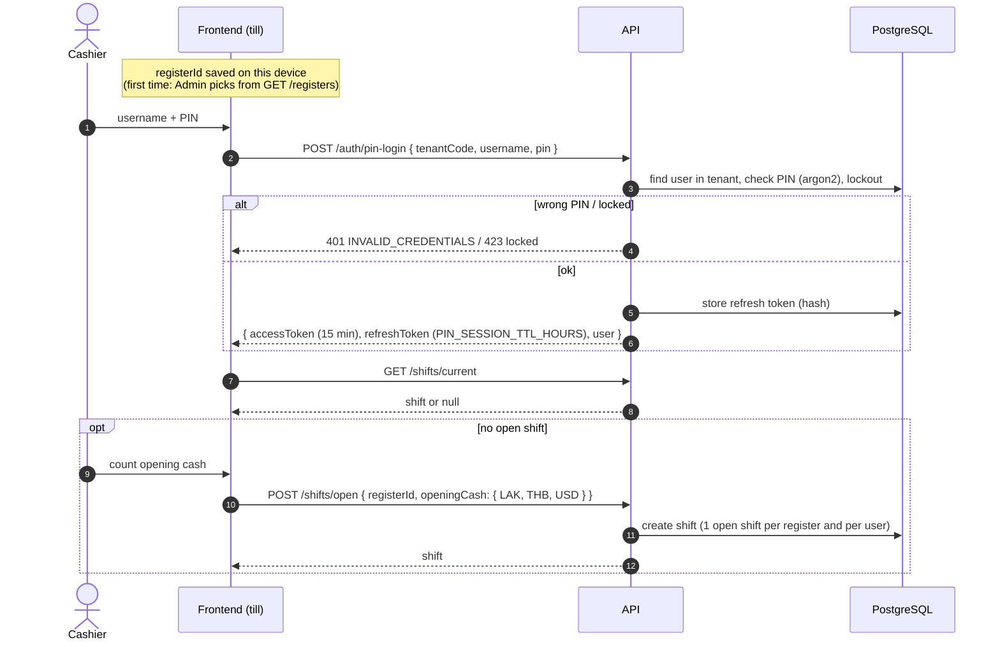
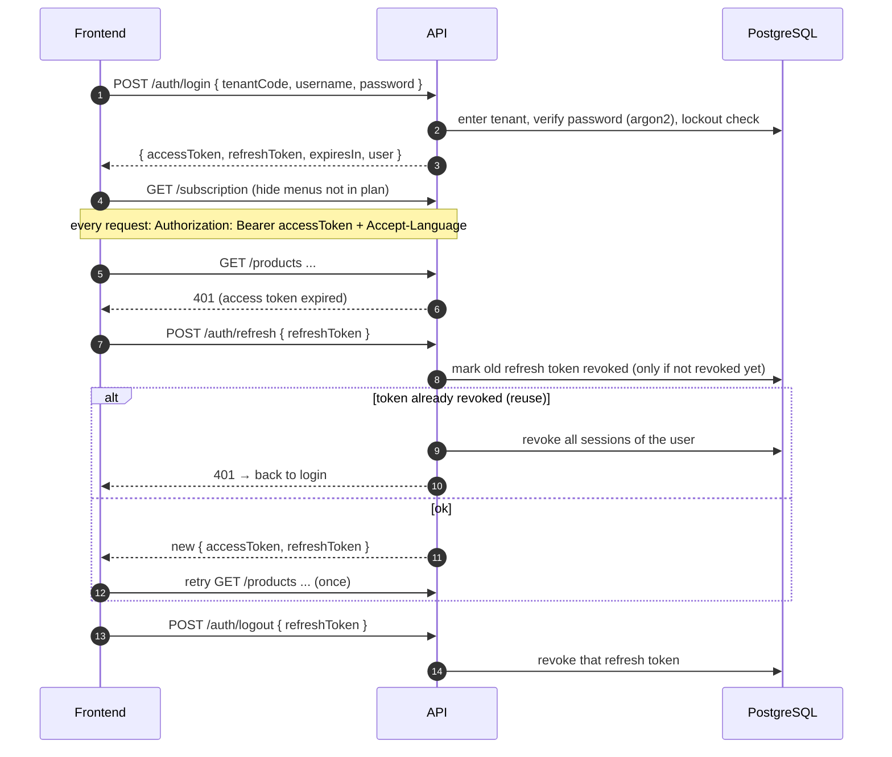
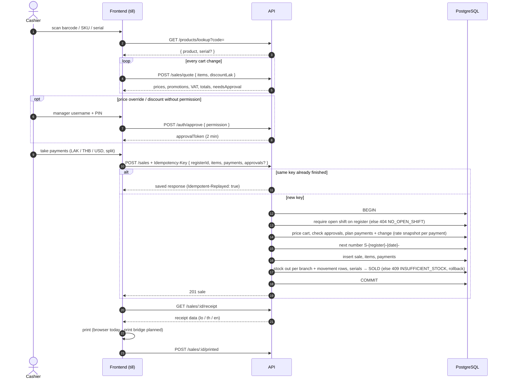

# PLC POS — ภาพรวม API (สำหรับทำ frontend)

> อัปเดตล่าสุด: 2026-10-27 (หลายบริษัท · หลายสาขา · แพ็กเกจ · 3 ภาษา — ดู [`saas-design.md`](./saas-design.md)) · Swagger ตัวเต็มอยู่ที่ `GET /api/docs` (JSON: `/api/docs-json`)
> ตารางและกฎธุรกิจดูได้ที่ [`database-design.md`](./database-design.md) · ขอบเขตงานดูได้ที่ [`product-plan.md`](./product-plan.md)
> ภาพรวมระบบ (diagram): [`database-design.md` §10](./database-design.md#10-สถาปัตยกรรมการติดตั้งและการพิมพ์) · สัญญา API แบบไฟล์: [`openapi.json`](./openapi.json) (import เข้า Postman ได้)

## ข้อตกลงทั่วไป

| เรื่อง | ข้อตกลง |
|---|---|
| Base URL | `/api` · ทุก route ต้องมี `Authorization: Bearer <accessToken>` ยกเว้น login, pin-login, refresh, logout, `/public/*` · `/platform/*` ใช้ token ของ platform admin แยกต่างหาก |
| บริษัท | login ส่ง `tenantCode` (รหัสบริษัท เช่น `plc`) + username + รหัสผ่าน/PIN · token ผูกกับบริษัท ทุกข้อมูลที่เห็นเป็นของบริษัทนั้นเท่านั้น · ถ้า server ตั้ง `DEFAULT_TENANT_CODE` ไม่ต้องส่ง |
| ภาษา | `?lang=lo|th|en` → ภาษาของผู้ใช้ (`PATCH /auth/me`) → `Accept-Language` → ภาษาเริ่มต้นของบริษัท · ชื่อหมวด/สินค้า/ประเภทชำระ/โปรโมชั่นแสดงตามภาษา และมี `nameI18n` ให้หน้าแก้ไข |
| เงิน | ส่งกลับเป็น **string** ทศนิยม (`"1300000"`, `"21800.5"`) ห้ามใช้ float คำนวณยอด · LAK เป็นจำนวนเต็ม · THB/USD มีทศนิยม 2 ตำแหน่ง |
| วันที่ | query `from`/`to` ใช้รูปแบบ `YYYY-MM-DD` ตามเวลา **Asia/Vientiane** (นับรวมทั้งสองวัน) · timestamp เป็น ISO UTC |
| แบ่งหน้า | `?page=1&pageSize=20&q=` → `{ items, total, page, pageSize }` · `pageSize` สูงสุด 100 · รายงานที่แบ่งหน้าจะมี `totals` รวมทุกแถว |
| Error | รูปแบบเดียวทุก error: `{ statusCode, code, message, detail?, requestId, errors?, ...params }` · **ให้ frontend ตัดสินใจจาก `code`** (ไม่เปลี่ยนตามภาษา) ส่วน `message` แสดงให้คนอ่านตามภาษา · `400` ข้อมูลไม่ถูกต้อง (`errors[]` มี `path`, `code`, `message`) · `401` · `402` แพ็กเกจหมดอายุ (อ่านได้อย่างเดียว) · `403` · `404` · `409` · `413` · `423` · `429` (ดู `Retry-After`) |
| Error code ที่ต้องดักจับ | `TENANT_REQUIRED` (`companies`) · `SIGNUP_CODE_INVALID` · `TOKEN_INVALID` · `GOOGLE_ACCOUNT_UNKNOWN` · `INVOICE_NOT_PENDING` · `APPROVAL_REQUIRED` (403: ต้องให้ผู้จัดการใส่ PIN) · `NO_OPEN_SHIFT` · `CREDIT_LIMIT` · `INSUFFICIENT_STOCK` · `BRANCH_REQUIRED` (ต้องเลือกสาขา) · `BRANCH_FORBIDDEN` · `FEATURE_NOT_IN_PLAN` (`feature`) · `PLAN_LIMIT_REACHED` (`limit`, `max`, `used`) · `SUBSCRIPTION_INACTIVE` (402) · `TENANT_SUSPENDED` · `INVALID_CREDENTIALS` · `MISSING_PERMISSION` · `VALIDATION_FAILED` · `IDEMPOTENCY_CONFLICT` |
| กันส่งซ้ำ | `POST /sales`, `/debt-payments`, `/sales/:id/returns` รับ header `Idempotency-Key` (8–100 ตัว, สุ่มใหม่ทุกบิล) · ส่งซ้ำด้วย key เดิม → ได้ผลลัพธ์เดิม (`Idempotent-Replayed: true`) ไม่เกิดบิลซ้ำ |
| ติดตามปัญหา | ทุก response มี `X-Request-Id` (ส่งมาเองได้) และอยู่ใน error body |
| เลขเอกสาร | (นับแยกต่อบริษัท) `S-R1-261026-0001` ขาย · `R-` คืน · `DP-` ชำระหนี้ · `GR-`/`GI-`/`ADJ-`/`TR-` สต็อก · `Q-` เสนอราคา · `T-` ซ่อม · `INV-2026-000001` ใบกำกับภาษี · `C00001` ลูกค้า |

## โมดูลและ route

| โมดูล | Route หลัก | สิทธิ์ |
|---|---|---|
| Health | `GET /health` (ไม่ต้องล็อกอิน) | — |
| Auth | `POST /auth/login` (email + password; if the same credentials match multiple companies, choose one; API clients may still use username), `/auth/pin-login` (tenantCode + username + PIN), `/auth/google` (`idToken`), `/auth/google/link`, `/auth/verify-email`, `/auth/resend-verification`, `/auth/forgot-password`, `/auth/reset-password`, `/auth/refresh`, `/auth/logout`, `GET/PATCH /auth/me` (ภาษา), `POST /auth/change-password`, `PUT /auth/pin`, `POST /auth/approve` | — |
| บริษัท/แพ็กเกจ | `GET /company`, `PATCH /company` (ชื่อ, ภาษาเริ่มต้น) · `GET /subscription` (แพ็กเกจ, สถานะ, ฟีเจอร์, limit และการใช้งาน) | แก้: `settings.manage` |
| สาขา | `GET /branches`, `POST /branches`, `PATCH /branches/:id` (`taxRateId` = VAT ของสาขา, `null` = ใช้ค่าเริ่มต้นของบริษัท) | แก้: `settings.manage` |
| ประวัติ | `GET /audit-logs` (`?action, entity, entityId, userId, from, to`) | `auditLog.view` + ฟีเจอร์ `auditLog` |
| สมัคร/ราคา | `GET /public/plans` · `POST /public/signup` → อีเมลรหัส 6 หลัก → `/public/signup/verify` (สร้างบริษัท + ได้ token) · `/public/signup/resend` · `/public/signup/google` (เปิดด้วย `SIGNUP_ENABLED`) | สาธารณะ |
| ค่าแพ็กเกจ | `POST /billing/checkout { planCode, months }`, `GET /billing/invoices`, `POST /billing/invoices/:id/cancel` · gateway เรียก `POST /public/billing/webhook` | `settings.manage` |
| Platform | `POST /platform/auth/login` · `/platform/plans` · `/platform/tenants` (+ `/:id/subscription`) · `/platform/invoices` (+ `/:id/mark-paid`) · `/platform/stats` | platform admin |
| ผู้ใช้/กลุ่ม | `/users` (CRUD + `branchIds` = สาขาที่เข้าได้ ว่าง = ทุกสาขา, `language`, `email` (ส่งลิงก์ยืนยันอัตโนมัติ), reset-password, pin, unlock), `/user-groups`, `/user-groups/permissions` | `users.manage` |
| ตั้งค่า | `GET/PATCH /settings`, `/tax-rates` (+`/:id/default`), `/exchange-rates` (`/current`), `/payment-types`, `/registers` | อ่าน: ทุกคน · แก้: `settings.manage` (อัตราแลกเปลี่ยน: `exchangeRate.manage`) |
| แคตตาล็อก | `/categories` (`?tree=true`), `/brands`, `/products` (search, `/lookup?code=` · ส่ง `?branchId=` เพื่อได้ราคาของสาขา · `PUT /:id/branch-prices` ราคาต่างกันตามสาขา, `/bulk-price`, `PUT /prices`, `/:id/images`, `/:id/bundle-items`), `/promotions` | อ่าน: `catalog.view` · แก้: `product.manage` |
| สต็อก | `/suppliers`, `/stock-documents` (`RECEIVE`/`ISSUE`/`ADJUST`/`TRANSFER` + `branchId`, `toBranchId` · draft → `/post` → `/cancel`), `/stock/movements`, `/stock/serials`, `/stock/serials/:serial/history`, `/stock/lots/expiring` | `stock.receive` / `stock.issue` / `stock.adjust` / `stock.transfer` |
| ลูกค้า | `/customers` (`?withDebt=true`), `/customers/:id/debts` | `customer.manage` / `debt.receive` |
| กะ | `POST /shifts/open`, `GET /shifts/current`, `/shifts/:id/report` (Z-report), `/shifts/:id/close`, `/shifts/:id/cash-movements` | `shift.operate` (`cash.move`) |
| ขาย | `POST /sales/quote`, `POST /sales`, `/sales/:id/receipt`, `/sales/:id/printed`, `/sales/:id/void`, `/sales/:id/tax-invoice`, `/held-bills`, `/tax-invoices` | `sale.create`, `sale.hold`, `sale.reprint`, `taxInvoice.issue` |
| คืนสินค้า | `POST /sales/:id/returns`, `/returns` | `return.create` (หรือขออนุมัติ) |
| หนี้ | `POST /debt-payments`, `GET /debt-payments` | `debt.receive` |
| รายจ่าย | `/expense-categories`, `/expenses` | `expense.manage` |
| ใบเสนอราคา | `/quotations` (+ `/status`, `/convert`) | `quotation.manage` |
| ซ่อม | `/service-tickets` (+ `/lines`, `/status`, `/deliver`) | `repair.receive` / `repair.manage` |
| รายงาน (ทุกตัวรับ `?branchId=`) | `/reports/dashboard`, `sales-summary`, `best-sellers`, `stock-value`, `stock-documents`, `debt-payments`, `debt-aging`, `expenses`, `voided-sales`, `customer-purchases`, `repairs` | `report.view` (ต้นทุน/กำไรต้องมี `product.viewCost` ด้วย) |

## ลำดับการทำงานที่ frontend ต้องใช้

### 1. เริ่มงานที่เครื่องขาย
1. เครื่องจำ `registerId` ของตัวเอง (Admin เลือกครั้งแรกจาก `GET /registers`)
2. แคชเชียร์ล็อกอินด้วย `POST /auth/pin-login` → เก็บ `accessToken` (15 นาที) + `refreshToken` · เมื่อได้ 401 ให้เรียก `POST /auth/refresh` แล้วยิงซ้ำ
3. `GET /shifts/current` → ถ้าได้ `null` ให้เปิดกะด้วย `POST /shifts/open { registerId, openingCash: { LAK, THB, USD } }`

### 1.1 ล็อกอินและบริษัท
- หน้า login ใช้ **อีเมล + รหัสผ่าน** → `POST /auth/login { email, password }` · ถ้าบัญชีตรงกับหลายบริษัท จะได้ `409 TENANT_REQUIRED` (หลังรหัสผ่านถูกต้อง) พร้อม `companies`; ส่งซ้ำพร้อม `tenantCode` ที่เลือก · API client เดิมยังใช้ `{ tenantCode, username, password }` ได้
- PIN sign-in ที่เครื่องขายยังใช้ `POST /auth/pin-login { tenantCode, username, pin }`
- ลืมรหัสผ่าน → `POST /auth/forgot-password { email }` → ผู้ใช้กดลิงก์ในอีเมล (`APP_URL/reset-password?token=`) → `POST /auth/reset-password { token, newPassword }` · ลิงก์ยืนยันอีเมลชี้ไป `APP_URL/verify-email?token=` → `POST /auth/verify-email { token }`
- สมัครร้านใหม่ → `POST /public/signup` → หน้าใส่รหัส 6 หลัก (หรือลิงก์ `APP_URL/signup/verify?request=&code=`) → `POST /public/signup/verify`
- หลังล็อกอิน `GET /subscription` เพื่อซ่อนเมนูที่แพ็กเกจไม่มี (`features`) และแสดงคำเตือนใกล้หมดอายุ (`trialEndsAt`, `currentPeriodEnd`, `graceEndsAt`) · ถ้าได้ `402 SUBSCRIPTION_INACTIVE` ให้แสดงว่าอ่านได้อย่างเดียว
- `GET /auth/me` มี `branchIds` (null = ทุกสาขา) และ `language`

Google: `POST /auth/google { idToken }` → ถ้าบัญชีอยู่หลายบริษัทจะได้ `409 TENANT_REQUIRED` พร้อม `companies` → ให้ผู้ใช้เลือกแล้วส่งซ้ำพร้อม `tenantCode`

### 2. ขาย
1. สแกน → `GET /products/lookup?code=` (รองรับบาร์โค้ด, SKU และ serial) → ถ้าได้ `serial` ให้ใส่ลงบรรทัดนั้นเลย
2. ทุกครั้งที่ตะกร้าเปลี่ยน → `POST /sales/quote` ได้ราคาจริง, โปรโมชั่น, VAT, ยอดรวม และ `needsApproval`
3. ถ้ามีการแก้ราคาหรือให้ส่วนลด และผู้ใช้ไม่มีสิทธิ์ → เปิดหน้าต่างให้ผู้จัดการใส่ username + PIN → `POST /auth/approve { permission }` → ได้ `approvalToken` (อายุ 2 นาที) → ส่งใน `approvals: { 'price.override': token }`
4. `POST /sales` พร้อม header `Idempotency-Key` (สร้างใหม่ต่อบิล, ใช้ key เดิมเมื่อส่งซ้ำ) `{ registerId, customerId?, items[{productId, quantity, serials?, componentSerials?, unitPriceLak?, discountLak?}], discountLak, payments[{paymentTypeId, currency, amount, reference?}], heldBillId? }`
5. `GET /sales/:id/receipt` → ส่งให้ print bridge (ESC/POS) → `POST /sales/:id/printed`

### 3. ยกเลิกบิล, คืนสินค้า, ใบกำกับภาษี
- ยกเลิกบิลได้เฉพาะบิลของกะที่ยังเปิดอยู่: `POST /sales/:id/void { reason, approvalToken? }`
- หลังปิดกะแล้วให้ใช้คืนสินค้า: `POST /sales/:id/returns { reason, paymentTypeId, items[{saleItemId, quantity, serials?, restock}] }`
- ใบกำกับภาษี: `POST /sales/:id/tax-invoice` → `GET /tax-invoices/:id` (ข้อมูลสำหรับพิมพ์ A4 พร้อมจำนวนเงินเป็นตัวอักษรภาษาลาว)

### 4. ปิดกะ
`GET /shifts/:id/report` (ดูยอดเงินที่ควรมี) → นับเงินจริง → `POST /shifts/:id/close { closingCash }` → ได้ Z-report พร้อมส่วนต่าง

### 5. รับสินค้าเข้า
`POST /stock-documents { type: 'RECEIVE', supplierId, currency, items[{productId, quantity, unitCost, serials?, lotNo?, expiryDate?}] }` → ตรวจทาน → `POST /stock-documents/:id/post`

### 5.1 โอนสินค้าข้ามสาขา
`POST /stock-documents { type: 'TRANSFER', branchId (ต้นทาง), toBranchId, items[{productId, quantity, serials?}] }` → `/post` · ยกเลิกหลัง post = โอนกลับ · สต็อกแยกสาขาดูได้ที่ `GET /products/:id` (`branchStock`)

### 6. ซ่อม
รับเครื่อง `POST /service-tickets { customerId, serial | deviceName, problem }` → ใส่ค่าใช้จ่าย `PUT /:id/lines` → เปลี่ยนสถานะ `POST /:id/status { READY }` → ส่งมอบ `POST /:id/deliver { registerId, payments }` (ถ้าอยู่ในประกันจะไม่เก็บเงิน)

## กลุ่มสิทธิ์เริ่มต้น

| กลุ่ม | สิทธิ์ |
|---|---|
| Admin | `*` |
| Manager | ทุกสิทธิ์ ยกเว้น `settings.manage`, `users.manage` |
| Cashier | `catalog.view`, `sale.create`, `sale.hold`, `sale.reprint`, `taxInvoice.issue`, `customer.manage`, `debt.receive`, `shift.operate`, `cash.move`, `repair.receive` |
| Viewer | `catalog.view` |

> **2026-10-30 (reports):** ชื่อวิธีชำระใน `GET /reports/sales-summary?groupBy=paymentType` (`label`) และ `/reports/debt-payments`, ชื่อหมวดใน `/reports/expenses` และ `/reports/stock-value` แปลตามภาษาของคำขอแล้ว

> **2026-10-30 (billing):** `payment.reference` (ข้อความในหมายเหตุการโอน) เป็น `<COMPANY-CODE>-<invoice number>` เช่น `PLC-LAO-BILL-2026-000001` เพราะเลขใบแจ้งหนี้เริ่มใหม่ในแต่ละบริษัท · `GET /platform/invoices` ส่ง `transferReference` เดียวกันเพื่อจับคู่กับรายการธนาคาร

> **2026-10-30:** ชื่อ `paymentType` ในบิล/ใบเสร็จ/ใบกำกับภาษี/คืนสินค้า/รับชำระหนี้ และ `category`/`paymentType` ใน `GET /expenses` แปลตามภาษาของคำขอแล้ว (ส่ง `nameI18n` มาด้วย) — ก่อนนี้ส่งชื่อฐาน (อังกฤษ) เสมอ

> **2026-10-29:** `GET /sales/:id/receipt` มี `branch` (ชื่อ, ที่อยู่, โทร, `receiptHeader`) ของสาขาที่ขาย · `from`/`to` ของ `GET /sales` และ `GET /tax-invoices` เป็นวันตามเวลาร้าน (Asia/Vientiane) · `GET /tax-invoices/:id` ไม่ส่ง `unitCostLak` · `from`/`to` ของ `GET /stock-documents` และ `/stock/movements` เป็นวันตามเวลาร้านเช่นกัน · `/stock/movements` และ `/stock/serials` รับ `branchId` และจำกัดตามสาขาที่ผู้ใช้เข้าถึงได้

## Postman

1. **Import** → [`postman/plc-pos.postman_collection.json`](./postman/plc-pos.postman_collection.json) เพื่อใช้ collection ที่จัดหมวดไว้แล้ว; import [`openapi.json`](./openapi.json) ได้เช่นกันเพื่อสร้าง collection จากสัญญา API
2. **Import** → [`postman/plc-pos.local.postman_environment.json`](./postman/plc-pos.local.postman_environment.json) แล้วใส่ `email` และ `password` ของผู้ใช้ในเครื่อง (อย่า commit ค่าจริง)
3. เลือก environment `PLC POS — local` แล้วส่ง `POST /auth/login`; token จะถูกบันทึกอัตโนมัติ · ถ้าได้ `TENANT_REQUIRED` ให้ส่งซ้ำพร้อม `tenantCode` ของบริษัทที่เลือก
4. Collection ตั้งค่า Bearer token = `{{accessToken}}` ไว้แล้ว · เมื่อ token หมดอายุ ให้ login ใหม่หรือใช้ `POST /auth/refresh`
5. API เปลี่ยน → `pnpm openapi:export` แล้ว import `openapi.json` ใหม่

## การทดสอบ

- `pnpm test`: unit test (เงิน, VAT, คำนวณราคา, จำนวนเงินเป็นตัวอักษร 3 ภาษา, สิทธิ์, เวลา, แพ็กเกจ/สิทธิ์ใช้งาน, cache แยกบริษัท)
- Windows ที่เปิด Smart App Control: migrate ฐานข้อมูล test ด้วย `$env:PRISMA_DATABASE_URL="…/plc_pos_test"; .\scripts\prisma.ps1 migrate deploy` แล้วรัน `E2E_SKIP_MIGRATE=1 pnpm test:e2e`
- `pnpm test:e2e`: 126 test ที่ยิง API จริงกับฐานข้อมูล `<db>_test` (migrate + seed ให้อัตโนมัติ และไม่ลบข้อมูล) รวมชุดหลายบริษัท/สาขา/แพ็กเกจ/ราคาตามสาขา (`saas`), อีเมล/Google (`account`), ค่าแพ็กเกจ (`billing`), ภาษา (`i18n`) และกันส่งซ้ำ (`ops`)
