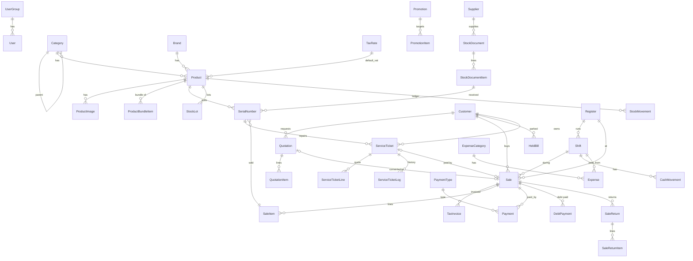
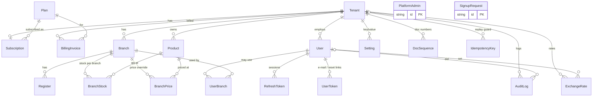
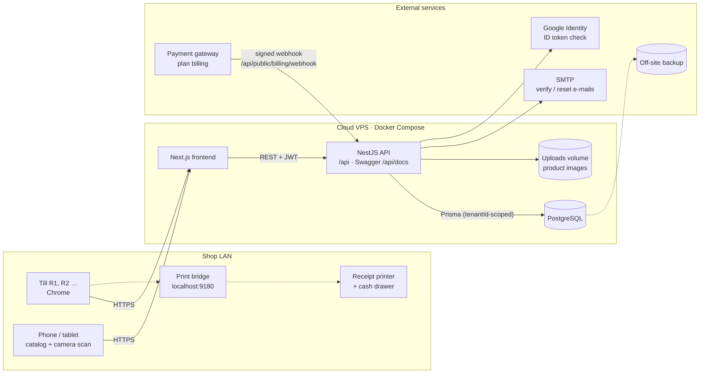

# PLC POS — การวิเคราะห์และออกแบบฐานข้อมูล

> สถานะ: **backend ครบทุกเฟสแล้ว (M0–M5, Phase 2–3)** · schema ใช้งานจริงใน `prisma/schema.prisma` · API ดูได้ที่ [`api-overview.md`](./api-overview.md)
> อัปเดตล่าสุด: 2026-10-26
>
> - เอกสารนี้เป็น "แหล่งความจริง" ของการออกแบบ — ก่อนเพิ่มหรือแก้ตารางต้องอ่านและอัปเดตไฟล์นี้ก่อนเสมอ
> - Schema: [`prisma/schema.prisma`](../prisma/schema.prisma) · ข้อมูลเริ่มต้น: [`prisma/seed.ts`](../prisma/seed.ts) · สิทธิ์: [`src/common/permissions.ts`](../src/common/permissions.ts)
> - แผนผลิตภัณฑ์ ขอบเขต MVP และ backlog: [`docs/product-plan.md`](./product-plan.md)

## 1. ขอบเขตธุรกิจ

ร้านขาย **อุปกรณ์ POS และสินค้าไอทีที่เกี่ยวข้อง** ใน สปป. ลาว ใช้ LAK เป็นสกุลเงินหลัก และรับ THB/USD ด้วย

| กลุ่มสินค้า | ตัวอย่าง | Serial | หมดอายุ | ประกัน |
|---|---|---|---|---|
| เครื่อง POS | POS จอคู่ (Sunmi T2s, iMin D4), POS มือถือ, All-in-One | ✅ | — | 12 เดือน |
| เครื่องพิมพ์ | ปริ้นเตอร์ใบเสร็จ Thermal 58/80mm, ปริ้นเตอร์ฉลาก, ปริ้นเตอร์ทั่วไป | ✅ | — | 6–12 เดือน |
| จอภาพ | จอทั่วไป (Samsung, MSI, LG, Dell), จอสัมผัส, จอแสดงผลลูกค้า | ✅ | — | 12–36 เดือน |
| เครื่องสแกน | สแกนบาร์โค้ด 1D/2D แบบมีสาย/ไร้สาย/ตั้งโต๊ะ | ✅ | — | 12 เดือน |
| คอมพิวเตอร์ | Mini PC, โน้ตบุ๊ก (MSI ฯลฯ) | ✅ | — | 12–24 เดือน |
| ลิ้นชักเก็บเงิน | Cash drawer RJ11 | เลือกได้ | — | 3–12 เดือน |
| อุปกรณ์เสริม | สาย, Hub, ขาตั้งจอ, UPS, เครื่องชั่ง | ❌ | — | 0–6 เดือน |
| วัสดุสิ้นเปลือง | กระดาษความร้อน, สติกเกอร์, ริบบอน, หมึก, แบตเตอรี่ | ❌ | ✅ | — |
| บริการ/ซอฟต์แวร์ | ค่าติดตั้ง, ค่าซ่อม, License | ❌ ไม่นับสต็อก | — | — |

**สภาพสินค้า:** มือหนึ่ง (NEW) และตัวโชว์ (DEMO) ซึ่งขายในราคาของตัวเองได้

## 2. คำตอบของเจ้าของโปรเจกต์ → การตัดสินใจออกแบบ

| # | คำถาม | คำตอบ | การตัดสินใจ |
|---|---|---|---|
| 1 | หลายสาขา? | ตอนนี้มีสาขาเดียว | ยังไม่ทำตาราง `Branch`/`Warehouse` ทุกตารางเป็นสาขาเดียว ถ้าจะขยายภายหลังให้เพิ่ม `branchId` ในตารางสต็อก ขาย และกะ |
| 2 | VAT? | ต้องการตาราง VAT | เพิ่มตาราง `TaxRate` ตั้งค่า VAT ได้หลายอัตรา มีค่าเริ่มต้นหนึ่งตัว ใบขายเก็บ snapshot `vatPercent`/`vatLak` และตั้งได้ว่าราคารวม VAT แล้วหรือยัง |
| 3 | ขายเชื่อ? | ยังไม่แน่ใจ | รองรับไว้ เพราะรายการฟีเจอร์มี "ติดหนี้ / ลูกค้าชำระหนี้ / รายงานชำระหนี้" ใช้ประเภทชำระเงิน `CREDIT` + `DebtPayment` และ**ปิดได้**ด้วยการตั้ง `PaymentType.isActive = false` |
| 4 | โปรโมชั่น/ราคาส่ง? | ต้องการ | `Product.wholesalePrice` + `wholesaleMinQty`, `Customer.priceTier` (RETAIL/WHOLESALE), ตาราง `Promotion` + `PromotionItem` |
| 5 | มือหนึ่ง/ตัวโชว์? | ขายมือหนึ่งและตัวโชว์ | `SerialNumber.condition` (NEW/DEMO) + `SerialNumber.priceLak` (ราคาเฉพาะชิ้น) |
| 6 | อัตรา VAT? | 12% และต้องเปลี่ยนได้ | seed `TaxRate` "VAT 12%" เป็นค่าเริ่มต้น แก้ได้ในหน้าตั้งค่า บิลเก่าไม่เปลี่ยนเพราะเก็บ snapshot ไว้ |
| 7 | ปัดราคากีบที่แปลงจาก USD/THB? | ปัด | ปัด**ขึ้น**เป็นหลักพัน โดยตั้งหน่วยการปัดได้ที่ `Setting` `pricing.lakRounding` (ค่าเริ่มต้น 1000) |
| 8 | ขายเชื่อ? | เปิดใช้ | ย้ายขายเชื่อและชำระหนี้มาไว้**เฟส 1** |
| — | ราคารวม VAT แล้วหรือยัง? (ยังไม่ได้ตอบ) | PM ตัดสินใจให้ก่อน | ค่าเริ่มต้น**รวม VAT แล้ว** (`tax.pricesIncludeVat = true`) ตามแบบร้านปลีกทั่วไป เปลี่ยนได้ใน `Setting` |
| D1 | ติดตั้งที่ไหน? | Cloud | backend + PostgreSQL บน cloud VPS, backup รายวัน (ดูหัวข้อ 10) |
| D2 | ขาย offline? | ยังไม่ต้องในเฟสแรก | ระบบออนไลน์อย่างเดียว ใช้ 4G เป็นเน็ตสำรอง |
| D3 | จำนวนเครื่องขาย? | หลายเครื่อง | เพิ่มตาราง `Register` · กะผูกกับเครื่อง (1 เครื่องเปิดได้ 1 กะ) · บิลระบุเครื่อง |
| D4 | วิธีพิมพ์? | ESC/POS ตรง + เปิดลิ้นชักอัตโนมัติ | Print bridge ในเครื่องขายแต่ละเครื่อง (ดูหัวข้อ 10) · ตั้งค่าเครื่องพิมพ์ใน `Register.printer` |
| D5 | รูปแบบใบกำกับภาษี? | ให้ PM ออกแบบ | เพิ่มตาราง `TaxInvoice` + รูปแบบในหัวข้อ 11 |
| D6 | ข้อมูลเดิมใน Excel? | ยังไม่มี | ไม่ต้องทำ import ใน MVP ให้กรอกผ่าน UI และตั้งสต็อกตั้งต้นด้วยเอกสาร RECEIVE |

## 3. ข้อกำหนดฟีเจอร์ (จาก UNIK POS) → ตาราง

### 3.1 ระบบขาย
| ฟีเจอร์ | รองรับโดย |
|---|---|
| เปิด-ปิดกะ | `Register` + `Shift` (+ `CashMovement`, `expectedCash`) |
| ขายด้วยการยิงบาร์โค้ดหรือเลือกสินค้า | `Product.barcode`/`sku`, `SerialNumber.serial` |
| ขายเป็น กีบ / บาท / ดอลลาร์ | `Payment.currency` + snapshot `lakPerUnit` |
| แสดงสินค้าพร้อมรูปและราคา | `ProductImage` |
| จอแสดงผลสำหรับลูกค้า | ฟีเจอร์ฝั่ง frontend (ไม่ต้องมีตาราง) |
| ส่วนลดรายสินค้าหรือส่วนลดรวมบิล | `SaleItem.discountLak`, `Sale.discountLak`, `Promotion` |
| แก้ราคาตอนขาย (เฉพาะผู้มีสิทธิ์) | `SaleItem.listPriceLak` เทียบกับ `unitPriceLak` + `priceOverriddenById` + สิทธิ์ `price.override` |
| แสดงยอดรวม VAT | `TaxRate`, `Sale.vatPercent`/`vatLak` |
| พักบิล | `HeldBill` |
| เลือกลูกค้าตอนขาย | `Sale.customerId` |
| รับเงินหลายประเภท: เงินสด, ติดหนี้, เงินโอน, QR | `PaymentType` (kind: CASH/CREDIT/BANK_TRANSFER/QR/CARD) + `Payment` |
| พิมพ์บิล 58mm / 80mm / A5 / A4 | `Setting` `receipt.defaultSize` (ฝั่ง frontend เลือกตอนพิมพ์) |
| พิมพ์บิลย้อนหลัง | `Sale.printCount` + `AuditLog` (SALE_REPRINT) |
| ยกเลิกการขาย (เฉพาะผู้มีสิทธิ์) | `Sale.status = VOIDED`, `voidedById`, `voidReason` + สิทธิ์ `sale.void` |

### 3.2 ระบบสต็อก
| ฟีเจอร์ | รองรับโดย |
|---|---|
| เพิ่มสินค้า, ใส่รูป | `Product`, `ProductImage` |
| ใส่ราคาต้นทุนเป็น บาท/ดอลลาร์/กีบ แล้วแปลงเป็นกีบ | `Product.costCurrency` + `costPrice` → `avgCostLak` |
| อัปเดตราคาได้ทุกเวลา, ปรับราคาหลายสินค้าพร้อมกัน | อัปเดต `Product` + `AuditLog` (PRODUCT_PRICE_BULK_UPDATE) |
| ราคาขายส่งและขายปลีก | `retailPrice`, `wholesalePrice`, `wholesaleMinQty` |
| จัดประเภทสินค้า | `Category` (แบบต้นไม้) + `Brand` |
| ใส่บาร์โค้ดหรือรหัสสินค้า | `Product.barcode`, `Product.sku` |
| แจ้งเตือนเมื่อสินค้าใกล้หมด | `Product.lowStockAlert` |
| รับสินค้าเข้าสต็อก | `StockDocument` (RECEIVE) + `StockDocumentItem` + `Supplier` |
| เบิกสินค้าออกจากสต็อก | `StockDocument` (ISSUE) |
| จัดการสินค้าหมดอายุ | `Product.trackExpiry` + `StockLot` |
| สินค้าไม่ระบุจำนวน (ขายโดยไม่นับสต็อก) | `Product.trackStock = false` |

### 3.3 ระบบจัดการ/ตั้งค่า
| ฟีเจอร์ | รองรับโดย |
|---|---|
| ข้อมูลร้าน: เบอร์โทร, ที่อยู่, โลโก้ | `Setting` (`store.*`) |
| อัปเดตอัตราแลกเปลี่ยน (ราคาเปลี่ยนตามอัตรา) | `ExchangeRate` + `Product.priceCurrency` (สินค้าที่ตั้งราคาเป็น USD/THB จะได้ราคากีบตามอัตราปัจจุบัน) |
| อัปเดต VAT | `TaxRate` |
| เปิด/ปิดประเภทชำระเงิน | `PaymentType.isActive` |
| เพิ่มผู้ใช้, เพิ่มกลุ่มผู้ใช้, จัดการสิทธิ์กลุ่ม | `User`, `UserGroup.permissions` |
| ตั้งค่าขนาดใบบิล | `Setting` (`receipt.*`) |

### 3.4 งานอื่น ๆ
| ฟีเจอร์ | รองรับโดย |
|---|---|
| บันทึกรายจ่าย, เพิ่มประเภทรายจ่าย | `Expense`, `ExpenseCategory` |
| แสดงรายการลูกหนี้, ลูกค้าชำระหนี้ | `Sale.paymentStatus`/`totalLak − paidLak`, `DebtPayment` |
| พิมพ์บาร์โค้ด | ฟีเจอร์ฝั่ง frontend (ใช้ `Product.barcode`) |

### 3.5 ระบบซ่อม
| ฟีเจอร์ | รองรับโดย |
|---|---|
| รับเครื่องซ่อม, ออกใบรับซ่อม | `ServiceTicket` |
| อัปเดตสถานะงานซ่อม | `ServiceTicket.status` + `ServiceTicketLog` |
| ออกใบเสนอราคาซ่อม | `ServiceTicketLine` (อะไหล่/ค่าแรง) → `quotedLak` (สถานะ QUOTED) |
| ออกบิลรับเงินค่าซ่อม | สร้าง `Sale` จากใบงาน (`ServiceTicket.saleId`) |
| ใส่เงื่อนไขรับประกันในบิลซ่อม | `ServiceTicket.warrantyDays`/`warrantyTerms` (ค่าเริ่มต้นจาก `Setting` `repair.warrantyTerms`) |

### 3.6 รายงาน (query จากตารางที่มีอยู่ ไม่ต้องมีตารางเพิ่ม)
| รายงาน | แหล่งข้อมูล |
|---|---|
| ยอดขาย / ยอดขายแบบสรุป | `Sale`, `SaleItem`, `Payment` |
| สินค้าขายดี | `SaleItem` group by product |
| สินค้า (คงเหลือ, มูลค่าสต็อก) | `Product`, `StockMovement` |
| รับสินค้า / เบิกสินค้า | `StockDocument` (RECEIVE / ISSUE) |
| ชำระหนี้ | `DebtPayment` |
| รายจ่าย | `Expense` |
| งานซ่อม | `ServiceTicket` |
| บิลที่ถูกยกเลิก | `Sale` where `status = VOIDED` |
| ยอดซื้อของลูกค้า | `Sale` group by customer |
| สินค้าหมดอายุ / ใกล้หมดอายุ | `StockLot.expiryDate` |
| กำไร | `SaleItem.unitPriceLak − unitCostLak` |

## 4. รายการตารางทั้งหมด (40 ตาราง + 8 ตาราง SaaS)

> **SaaS (2026-10-27):** เพิ่ม `Tenant`, `Branch`, `BranchStock`, `UserBranch`, `Plan`, `Subscription`, `PlatformAdmin`, `IdempotencyKey` · ทุกตารางของบริษัทมี `tenantId` และค่าที่ต้องไม่ซ้ำกลายเป็น "ไม่ซ้ำภายในบริษัท" · ตารางที่ผูกกับสาขามี `branchId` · รายละเอียดและเหตุผลอยู่ใน [`saas-design.md`](./saas-design.md)

✅ = มีใน schema ปัจจุบัน (อาจมีฟิลด์เพิ่ม), 🆕 = ตารางใหม่

| โมดูล | ตาราง |
|---|---|
| ผู้ใช้และระบบ (8) | 🆕 `UserGroup`, ✅ `User` (เปลี่ยน enum `role` เป็น `groupId`), 🆕 `RefreshToken`, 🆕 `Setting`, 🆕 `AuditLog`, 🆕 `PaymentType` (แทน enum `PaymentMethod`), 🆕 `TaxRate`, ✅ `ExchangeRate` |
| แคตตาล็อก (7) | ✅ `Category` (แบบต้นไม้), ✅ `Brand`, ✅ `Product`, 🆕 `ProductImage`, 🆕 `ProductBundleItem`, 🆕 `Promotion`, 🆕 `PromotionItem` |
| สต็อก (6) | ✅ `SerialNumber`, 🆕 `StockLot`, 🆕 `Supplier`, 🆕 `StockDocument`, 🆕 `StockDocumentItem`, 🆕 `StockMovement` |
| การขาย (11) | ✅ `Customer`, 🆕 `HeldBill`, 🆕 `Quotation`, 🆕 `QuotationItem`, ✅ `Sale`, ✅ `SaleItem`, ✅ `Payment`, 🆕 `TaxInvoice`, 🆕 `DebtPayment`, 🆕 `SaleReturn`, 🆕 `SaleReturnItem` |
| เครื่องขาย กะ เงินสด รายจ่าย (5) | 🆕 `Register`, ✅ `Shift`, 🆕 `CashMovement`, 🆕 `ExpenseCategory`, 🆕 `Expense` |
| ซ่อม/รับประกัน (3) | 🆕 `ServiceTicket`, 🆕 `ServiceTicketLine`, 🆕 `ServiceTicketLog` |

**สิ่งที่เปลี่ยนจากร่างรอบแรก:** เพิ่ม `UserGroup`, `PaymentType`, `TaxRate`, `Promotion(Item)`, `StockLot`, `HeldBill`, `DebtPayment`, `Expense(Category)`, `ServiceTicketLine/Log` และเปลี่ยน `PurchaseOrder` เป็น `StockDocument` ที่ใช้ได้ทั้งรับเข้า เบิกออก และปรับยอด (ฟีเจอร์ที่ต้องการไม่มีขั้น "สั่งซื้อ" แยก)

## 5. ER Diagram (ภาพรวม)



### 5.1 ER Diagram: หลายบริษัท (SaaS), สาขา และตารางระบบ

ตารางที่ไม่อยู่ในภาพบน · ทุกตารางของบริษัทมี `tenantId` (ภาพนี้แสดงเส้นไป `Tenant` เฉพาะตารางหลัก เพื่อไม่ให้รก) · `Plan`, `PlatformAdmin`, `SignupRequest` เป็นของ platform ไม่ผูกกับบริษัท



## 6. กฎทางธุรกิจหลัก

**เงินและราคา**
1. เงิน LAK = `Decimal(18,0)`, THB/USD = `Decimal(18,2)`, อัตราแลกเปลี่ยน = `Decimal(18,4)`, เปอร์เซ็นต์ = `Decimal(5,2)`
2. ราคาสินค้าเก็บใน `priceCurrency` ถ้าเป็น USD/THB ราคากีบจะเท่ากับ `price × อัตราปัจจุบัน` **ปัดขึ้น**ตามหน่วย `pricing.lakRounding` (ค่าเริ่มต้น 1,000 กีบ) แล้ว snapshot ไว้ใน `SaleItem`
3. ลำดับการเลือกราคา: ราคาเฉพาะชิ้นของตัวโชว์ (`SerialNumber.priceLak`) → ราคาส่ง (ถ้าลูกค้าเป็น WHOLESALE หรือจำนวนถึง `wholesaleMinQty`) → ราคาปลีก จากนั้นจึงหักโปรโมชั่นที่ใช้ได้และดีที่สุด**หนึ่งรายการ**
4. แก้ราคาด้วยมือได้เฉพาะผู้มีสิทธิ์ `price.override` โดยบันทึก `priceOverriddenById` + `AuditLog`
5. VAT (ค่าเริ่มต้น 12%): ใบขาย snapshot `vatPercent` จาก `TaxRate` ที่เป็นค่าเริ่มต้น ถ้าราคารวม VAT แล้ว `vatLak = total × p / (100 + p)` ถ้ายังไม่รวม `vatLak = (subtotal − discount) × p / 100`

**การขายและการชำระเงิน**
6. ผลรวมของ `Payment.amountLak` ต้องไม่น้อยกว่า `Sale.totalLak` โดยการชำระแบบ `CREDIT` นับเป็นหนี้ และเงินทอนคืนเป็น LAK เท่านั้น
7. ขายเชื่อต้องเลือกลูกค้าทุกครั้ง และยอดค้างชำระรวมต้องไม่เกิน `creditLimitLak` (ถ้าเป็น 0 แปลว่าไม่อนุญาต) สถานะคำนวณจาก `paidLak` เป็น `PAID`/`PARTIAL`/`UNPAID`
8. `DebtPayment` เพิ่ม `Sale.paidLak` และอัปเดต `paymentStatus` ใน transaction เดียวกัน
9. บิลที่พักไว้ (`HeldBill`) ไม่ตัดสต็อกและไม่จอง serial แต่จะตรวจสอบใหม่ตอนเปิดกลับมาขาย
10. ยกเลิกบิล (Void): ต้องมีสิทธิ์ `sale.void` (หรือให้ผู้จัดการใส่ PIN อนุมัติที่เครื่องแคชเชียร์) → คืนสต็อก (`VOID_IN`) และคืน serial เป็น `IN_STOCK` + `AuditLog` ถ้าเป็นบิลข้ามวันหรือคืนบางรายการให้ใช้ `SaleReturn`

**สต็อก**
11. ทุกการเปลี่ยนสต็อกต้องอยู่ใน transaction เดียว: `Product.stockQty` + `StockMovement` (+ `SerialNumber` / `StockLot`)
12. สินค้าที่มี serial ต้องสแกน serial ครบตามจำนวน และ serial ต้องมีสถานะ `IN_STOCK` → เมื่อขายเปลี่ยนเป็น `SOLD` และตั้ง `soldAt` กับ `warrantyEndsAt = soldAt + warrantyMonths`
13. `BUNDLE` ไม่มีสต็อกของตัวเอง ให้ตัดสต็อกจากส่วนประกอบ ถ้าส่วนประกอบมี serial ต้องสแกน · `SERVICE` และ `trackStock = false` ไม่ตัดสต็อก
14. สินค้าที่มีวันหมดอายุตัดสต็อกแบบ FEFO (ล็อตที่หมดอายุก่อนออกก่อน)
15. ต้นทุนใช้ค่าเฉลี่ยถ่วงน้ำหนัก (`avgCostLak`) คำนวณใหม่ทุกครั้งที่ POST เอกสารรับสินค้า
16. `StockDocument` แก้ไขได้เฉพาะตอนเป็น DRAFT เมื่อ POST แล้วจะสร้าง movement และยกเลิกได้ด้วยเอกสารกลับรายการเท่านั้น

**สิทธิ์ (UserGroup เริ่มต้น)**
| กลุ่ม | สิทธิ์หลัก |
|---|---|
| Admin | ทั้งหมด |
| Manager | ขาย, void, แก้ราคา, คืนสินค้า, สต็อก, รายจ่าย, รายงาน, ซ่อม |
| Cashier | ขาย, พักบิล, เปิด/ปิดกะ, รับชำระหนี้, รับเครื่องซ่อม |
| Viewer | ดูแคตตาล็อกและสแกนดูรายละเอียด (ไม่เห็นต้นทุน) — เดิมคือ role `USER` |

**เลขเอกสาร:** `S-YYMMDD-0001` (ขาย), `DP-` (ชำระหนี้), `GR-` (รับเข้า), `GI-` (เบิกออก), `ADJ-`, `Q-` (เสนอราคา), `R-` (คืนสินค้า), `T-` (ใบงานซ่อม) โดยตั้ง prefix ได้ใน `Setting`

## 7. แผนการพัฒนา

สร้าง schema ทั้ง 40 ตารางใน migration เดียว (ยังไม่มีข้อมูลจริง) แล้วพัฒนา API ไปทีละเฟส

| เฟส | เนื้อหา |
|---|---|
| **1 — แกนหลัก** | Auth + กลุ่ม/สิทธิ์ + PIN, ตั้งค่าร้าน, VAT, ประเภทชำระเงิน, อัตราแลกเปลี่ยน, หมวดหมู่/แบรนด์/สินค้า/รูป, รับสินค้าเข้า, ขายหน้าร้าน (serial, หลายสกุลเงิน, ส่วนลด, พักบิล, void), **ขายเชื่อ + ชำระหนี้**, กะ + รายงานปิดกะ, รายงานยอดขาย |
| **2 — สต็อกและการขายขั้นสูง** | เบิกออก/ปรับยอด/ตรวจนับ, ล็อตหมดอายุ, คืนสินค้า, ราคาส่ง + โปรโมชั่น, รายจ่าย, ปรับราคาหลายรายการ, รายงานที่เหลือ |
| **3 — ซ่อมและ B2B** | ใบงานซ่อม (รับเครื่อง, เสนอราคา, สถานะ, บิล, รับประกัน), ใบเสนอราคาขาย, ชุดสินค้า |
| **ภายหลัง** | หลายสาขา (`Branch`), สะสมแต้มลูกค้า |

## 8. ข้อมูลเริ่มต้น (seed)

**หมวดหมู่**
```
pos-terminal        เครื่อง POS          → pos-dual-screen, pos-single-screen, pos-handheld
printer             เครื่องพิมพ์          → printer-receipt, printer-label, printer-office
display             จอภาพ               → display-monitor, display-touch, display-customer
scanner             เครื่องสแกน           → scanner-handheld, scanner-desktop
computer            คอมพิวเตอร์ (Mini PC / โน้ตบุ๊ก)
cash-drawer         ลิ้นชักเก็บเงิน
accessory           อุปกรณ์เสริม
consumable          วัสดุสิ้นเปลือง
software            ซอฟต์แวร์ / License
service             บริการ (ติดตั้ง, ซ่อม)
```
**แบรนด์:** Sunmi, iMin, Epson, Xprinter, Zebra, Honeywell, MSI, Samsung, LG, Dell, HP, Canon, Brother, Generic
**ประเภทชำระเงิน:** เงินสด (CASH), เงินโอน (BANK_TRANSFER), QR (QR), บัตร (CARD, ปิดไว้), ติดหนี้ (CREDIT)
**VAT:** "VAT 12%" (ค่าเริ่มต้น), "ไม่มี VAT 0%"
**Setting เริ่มต้น:** `tax.pricesIncludeVat = true`, `pricing.lakRounding = 1000`, `receipt.defaultSize = "80mm"`, `app.timezone = "Asia/Vientiane"`
**ประเภทรายจ่าย:** ค่าเช่า, ค่าไฟ/น้ำ, เงินเดือน, ค่าขนส่ง, อื่น ๆ
**กลุ่มผู้ใช้:** Admin, Manager, Cashier, Viewer

หมายเหตุ frontend: `CATEGORY_IDS` ใน `src/features/products/mock-data.ts` ต้องเปลี่ยนไปใช้ `Category.slug` และ `priceLak` จะมาจาก API (คำนวณจาก `priceCurrency` + อัตราแลกเปลี่ยน)

## 9. คำถามที่ยังเปิดอยู่

ไม่มีแล้ว ดูการตัดสินใจทั้งหมดได้ในหัวข้อ 2 และ `docs/product-plan.md`

## 10. สถาปัตยกรรมการติดตั้งและการพิมพ์

เส้นทึบ = มีในโค้ดแล้ว · เส้นประ = วางแผนไว้ ยังไม่ได้ทำ (print bridge, backup อัตโนมัติ, frontend ใน `docker-compose.prod.yml`)



- **Cloud:** backend, frontend และ PostgreSQL อยู่บน VPS เดียวกัน (Docker Compose) ใช้ HTTPS · backup `pg_dump` ทุกวันเก็บ 30 วันไว้นอกเครื่อง · ทุกเครื่องขายใช้เบราว์เซอร์ ไม่ต้องติดตั้งโปรแกรม POS
- **ทำไมต้องมี print bridge:** cloud มองไม่เห็นเครื่องพิมพ์ใน LAN ของร้าน และเบราว์เซอร์ส่ง ESC/POS ไปเครื่องพิมพ์ USB บน Windows ได้ไม่เสถียร จึงติดตั้งโปรแกรมเล็ก ๆ (print bridge) ในเครื่องขายแต่ละเครื่อง ให้รับคำสั่งจากหน้าเว็บที่ `http://localhost:9180` แล้วส่งต่อไปเครื่องพิมพ์
  - frontend สร้างข้อมูลใบเสร็จ → bridge แปลงเป็น ESC/POS (58/80mm) → พิมพ์ + ส่งคำสั่งเปิดลิ้นชัก (`ESC p`) เมื่อชำระด้วยเงินสด
  - ใบ A4/A5 (ใบกำกับภาษี, ใบเสนอราคา) ใช้ปุ่มพิมพ์ของเบราว์เซอร์ หรือดาวน์โหลด PDF
  - เครื่อง Android (Sunmi/iMin) ที่มีเครื่องพิมพ์ในตัว: ทำทีหลัง (ผ่าน SDK ของผู้ผลิต)
  - ถ้า bridge ไม่ทำงาน ให้กลับไปใช้การพิมพ์ผ่านเบราว์เซอร์ การขายต้องไม่ติดขัด
- **เครื่องขาย (`Register`):** แต่ละเครื่องมีรหัส (R1, R2 …) และค่าตั้งเครื่องพิมพ์ เบราว์เซอร์จำว่าตัวเองเป็นเครื่องไหน (เลือกครั้งแรกโดย Admin) · 1 เครื่องเปิดได้ 1 กะ แต่ผู้ใช้คนเดียวกันเปิดกะคนละเครื่องไม่ได้ · เลขใบเสร็จต่อด้วยรหัสเครื่องได้ เช่น `S-R1-261026-0001`

## 11. รูปแบบใบกำกับภาษี (ใบเกັບເງິນ ອາກອນມູນຄ່າເພີ່ມ)

> ⚠️ ต้องให้นักบัญชีของร้านตรวจกับข้อกำหนดของกรมภาษี สปป.ลาว ที่ใช้อยู่ก่อนเปิดใช้จริง

**กฎ**
- ออกได้เฉพาะบิลที่ `COMPLETED` · ข้อมูลผู้ซื้อ snapshot ไว้ใน `TaxInvoice` (แก้ลูกค้าภายหลังแล้วใบเดิมไม่เปลี่ยน)
- เลขที่รันต่อเนื่องแยกจากใบเสร็จ: `INV-YYYY-000001` (ขึ้นปีใหม่เริ่ม 1) · **ห้ามลบ** · ยกเลิกได้โดยต้องระบุเหตุผล แล้วออกใบใหม่ (1 บิลมีใบที่ยังไม่ยกเลิกได้ 1 ใบเท่านั้น)
- void บิลที่มีใบกำกับภาษีอยู่ → ต้องยกเลิกใบกำกับก่อน
- จำนวนเงินแสดงเป็น LAK เสมอ ถ้าลูกค้าจ่าย USD/THB ให้แสดงอัตราแลกเปลี่ยนที่ใช้

**เลย์เอาต์ A4**
```
┌─────────────────────────────────────────────────────────────┐
│ [โลโก้]  ชื่อร้าน / ชื่อบริษัท                 ໃບເກັບເງິນ          │
│          ที่อยู่ · โทร · อีเมล                  TAX INVOICE        │
│          ເລກປະຈຳຕົວຜູ້ເສຍອາກອນ (TIN): xxxxxxxx              │
├─────────────────────────────────────────────────────────────┤
│ เลขที่: INV-2026-000123        วันที่: 26/10/2026              │
│ อ้างอิงใบเสร็จ: S-R1-261026-0007                              │
│ ผู้ซื้อ: ชื่อ/บริษัท · TIN · ที่อยู่ · โทร                        │
├────┬──────────────────────┬─────┬────────────┬──────────────┤
│ #  │ รายการ (รุ่น / Serial) │ จำนวน│ ราคา/หน่วย  │ จำนวนเงิน     │
├────┴──────────────────────┴─────┴────────────┴──────────────┤
│                              รวมก่อน VAT        xxx,xxx,000 ₭ │
│                              ส่วนลด               -xx,000 ₭ │
│                              VAT 12%            xx,xxx,000 ₭ │
│                              ยอดรวมทั้งสิ้น      xxx,xxx,000 ₭ │
│ จำนวนเงินเป็นตัวอักษร (ภาษาลาว): ...                            │
│ ชำระโดย: เงินโอน (ref ...) / USD 1,000 @ 21,800              │
├─────────────────────────────────────────────────────────────┤
│ ผู้ซื้อ ________________        ผู้ขาย / ผู้มีอำนาจ ________________ │
└─────────────────────────────────────────────────────────────┘
```
- ราคาที่ตั้งรวม VAT (`pricesIncludeVat = true`) → แยก VAT ออกมาแสดง: `VAT = รวม × 12 / 112`
- Serial ของสินค้าที่มีประกันพิมพ์ใต้ชื่อรายการ
- ข้อมูลร้าน (ชื่อบริษัท, TIN, ที่อยู่) มาจาก `Setting` `store.*` · เพิ่ม key `store.taxId`, `store.companyName`

## 12. การยืนยันตัวตน (Auth) — ทำแล้วใน M1.1

- **Access token:** JWT HS256 อายุ 15 นาที (`ACCESS_TOKEN_TTL`) ใน token เก็บแค่ `sub` (user id) ส่วนผู้ใช้และสิทธิ์โหลดใหม่ทุก request ดังนั้นการปิดผู้ใช้หรือเปลี่ยนสิทธิ์จะมีผลทันที
- **Refresh token:** สุ่ม 32 bytes เก็บเฉพาะค่า SHA-256 ใน `RefreshToken` · login ด้วยรหัสผ่านอายุ 7 วัน, login ด้วย PIN อายุ 12 ชม. · **หมุนทุกครั้ง** (rotation) ถ้ามีการใช้ token เก่าซ้ำจะเพิกถอนทุก session ของผู้ใช้นั้น
- **ล็อกบัญชี:** รหัสผ่านหรือ PIN ผิด 5 ครั้งติด → ล็อก 15 นาที (HTTP 423) · ข้อความ error เหมือนกันทั้งกรณีไม่มีผู้ใช้และรหัสผิด
- **Guard:** ทุก route ต้องล็อกอิน ยกเว้นที่ติด `@Public()` · `@RequirePermissions('sale.void')` ตรวจสิทธิ์จาก `UserGroup.permissions` (`*` = ทั้งหมด)
- **อื่น ๆ:** เปลี่ยนรหัสผ่านแล้วออกจากระบบทุกเครื่อง · ตั้ง PIN ต้องยืนยันด้วยรหัสผ่าน · header `Authorization` ถูกซ่อนใน log
