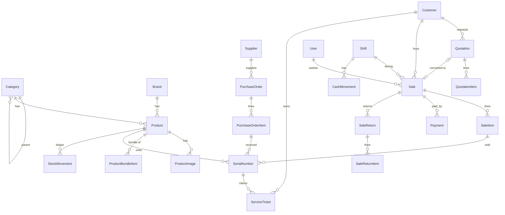

# PLC POS — การวิเคราะห์และออกแบบฐานข้อมูล

> สถานะ: **ร่างออกแบบ (รอยืนยันจากเจ้าของโปรเจกต์ก่อนแก้ `prisma/schema.prisma`)**
> อัปเดตล่าสุด: 2026-10-26
>
> เอกสารนี้เป็น "แหล่งความจริง" ของการออกแบบระบบ — ก่อนเพิ่ม/แก้ตาราง ให้อ่านและอัปเดตไฟล์นี้ก่อนเสมอ

## 1. ขอบเขตธุรกิจ

ร้านขาย **อุปกรณ์ POS และสินค้าไอทีที่เกี่ยวข้อง** ใน สปป. ลาว (สกุลเงินหลัก LAK, รับ THB/USD)

| กลุ่มสินค้า | ตัวอย่าง | ติดตาม Serial? | ประกัน |
|---|---|---|---|
| เครื่อง POS | POS จอคู่ (Sunmi T2s, iMin D4), POS มือถือ (Sunmi V2 Pro), All-in-One | ✅ | 12 เดือน |
| เครื่องพิมพ์ | ปริ้นเตอร์ใบเสร็จ Thermal 58/80mm, ปริ้นเตอร์ฉลาก, ปริ้นเตอร์ทั่วไป (Laser/Inkjet) | ✅ | 6–12 เดือน |
| จอภาพ | จอทั่วไป (Samsung, MSI, LG, Dell), จอสัมผัส, จอแสดงผลลูกค้า (VFD/LCD) | ✅ | 12–36 เดือน |
| เครื่องสแกน | สแกนบาร์โค้ด 1D/2D แบบมีสาย/ไร้สาย/ตั้งโต๊ะ | ✅ | 12 เดือน |
| คอมพิวเตอร์ | Mini PC, โน้ตบุ๊ก, PC (MSI ฯลฯ) | ✅ | 12–24 เดือน |
| ลิ้นชักเก็บเงิน | Cash drawer RJ11 | ❌ (เลือกได้) | 3–12 เดือน |
| อุปกรณ์เสริม | USB hub, สาย LAN/USB, ขาตั้งจอ, UPS, เครื่องชั่ง | ❌ | 0–6 เดือน |
| วัสดุสิ้นเปลือง | กระดาษความร้อน, สติกเกอร์บาร์โค้ด, ริบบอน, หมึก | ❌ | — |
| ซอฟต์แวร์/บริการ | License โปรแกรม POS, ค่าติดตั้ง, ค่าซ่อม | ❌ (ไม่มีสต็อก) | — |

แบรนด์ตัวอย่าง: Sunmi, iMin, Epson, Xprinter, Zebra, Honeywell, MSI, Samsung, LG, Dell, HP, Canon, Brother, Generic

### ลักษณะเฉพาะของร้านประเภทนี้ (ส่งผลต่อการออกแบบ)
1. **สินค้ามี Serial และประกัน** → ต้องติดตามว่า serial ไหน รับเข้าจากใคร ขายให้ใคร หมดประกันวันไหน
2. **รับเคลมและงานซ่อม** → ลูกค้านำเครื่องกลับมาเคลม/ซ่อมบ่อย
3. **ขายเป็นชุด (Bundle)** → เช่น "ชุด POS ร้านอาหาร" = เครื่อง POS + ลิ้นชัก + ปริ้นเตอร์ + สแกนเนอร์
4. **ลูกค้าธุรกิจ (B2B)** → ต้องออก**ใบเสนอราคา**ก่อนขาย, ต้องมีเลขผู้เสียภาษี/ชื่อบริษัท
5. **สเปกสินค้าต่างกันมากตามหมวด** → จอ (ขนาด/ความละเอียด), ปริ้นเตอร์ (ความกว้างกระดาษ/ความเร็ว) → เก็บเป็น JSON
6. **รับสินค้าจากผู้จำหน่ายหลายราย ต้นทุนเปลี่ยนตามล็อต** → ต้องมีใบสั่งซื้อ/รับสินค้า และประวัติการเคลื่อนไหวสต็อก

## 2. วิเคราะห์ schema ปัจจุบัน (`prisma/schema.prisma`)

มีอยู่แล้ว 11 ตาราง: `User`, `Category`, `Brand`, `Product`, `SerialNumber`, `Customer`, `ExchangeRate`, `Shift`, `Sale`, `SaleItem`, `Payment`

**จุดแข็ง:** โครงหน้าร้านพื้นฐานใช้ได้แล้ว — แยกสกุลเงินพร้อม snapshot อัตราแลกเปลี่ยนต่อการชำระ, จ่ายหลายสกุลต่อบิลได้, เงินใช้ `Decimal` ถูกต้อง, มี serial และกะการขาย

**ช่องว่าง / ปัญหาที่พบ:**

| # | ปัญหา | ผลกระทบ | วิธีแก้ |
|---|---|---|---|
| G1 | `Category` เป็นแบบชั้นเดียว | แยก "ปริ้นเตอร์ > Thermal / Label / ทั่วไป" ไม่ได้ | เพิ่ม `parentId` (ต้นไม้หมวดหมู่) |
| G2 | `Product` ไม่มี specs / รูป / ตำแหน่งชั้นวาง / รุ่น | frontend (mock-data) ใช้ `specs`, `location` อยู่แล้ว | เพิ่ม `model`, `specs Json`, `location`, `ProductImage` |
| G3 | `stockQty` เปลี่ยนตรง ๆ ไม่มีประวัติ | ตรวจสอบย้อนหลังไม่ได้ว่าสต็อกหายไปไหน | เพิ่ม `StockMovement` (สมุดบัญชีสต็อก) |
| G4 | ไม่มีผู้จำหน่าย/ใบสั่งซื้อ/รับสินค้า | ไม่รู้ต้นทุนจริง ไม่รู้ serial มาจากล็อตไหน | เพิ่ม `Supplier`, `PurchaseOrder`, `PurchaseOrderItem` |
| G5 | `SaleItem` ไม่เก็บต้นทุน ณ วันขาย | รายงานกำไรผิดเมื่อต้นทุนเปลี่ยน | เพิ่ม `unitCostLak` ใน `SaleItem` |
| G6 | คืนสินค้าทำได้แค่เปลี่ยน `Sale.status` | คืนบางรายการ/บางชิ้นไม่ได้ ไม่มีบันทึกการคืนเงิน | เพิ่ม `SaleReturn`, `SaleReturnItem` |
| G7 | `SerialNumber.saleItemId` ช่องเดียว | ถ้าเครื่องถูกคืนแล้วขายใหม่ ประวัติการขายครั้งแรกหาย | ประวัติดูจาก `StockMovement`; เพิ่ม `purchaseItemId`, `warrantyEndsAt` |
| G8 | ไม่มีระบบเคลม/ซ่อม | งานหลักของร้านอุปกรณ์ทำไม่ได้ | เพิ่ม `ServiceTicket` |
| G9 | ไม่มีชุดสินค้า | ขายชุด POS ไม่สะดวก ตัดสต็อกผิด | เพิ่ม `ProductBundleItem` |
| G10 | ไม่มีใบเสนอราคา | ลูกค้า B2B ต้องการ | เพิ่ม `Quotation`, `QuotationItem` |
| G11 | `Customer` ไม่มีข้อมูลบริษัท | ออกใบกำกับให้ธุรกิจไม่ได้ | เพิ่ม `type`, `companyName`, `taxId` |
| G12 | `Payment` ไม่มีเลขอ้างอิง | ตรวจสอบยอดโอน/QR ไม่ได้ | เพิ่ม `reference` |
| G13 | `Sale` ไม่มีผู้ยกเลิก/เหตุผล/หมายเหตุ | ตรวจสอบการ void ไม่ได้ | เพิ่ม `note`, `voidedById`, `voidedAt`, `voidReason` |
| G14 | ไม่มีเงินเข้า-ออกลิ้นชักระหว่างกะ | ปิดกะแล้วเงินไม่ตรง | เพิ่ม `CashMovement` |
| G15 | ไม่มีการตั้งค่าร้าน / audit log / refresh token | หัวใบเสร็จ, VAT, การล็อกอิน, ตรวจสอบย้อนหลัง | เพิ่ม `Setting`, `AuditLog`, `RefreshToken` |
| G16 | `ExchangeRate.createdById` ไม่มี relation | ข้อมูลไม่สมบูรณ์ | เพิ่ม relation กับ `User` |

## 3. รายการตารางที่ควรมี (ข้อเสนอ)

แบ่งเป็นโมดูล — ✅ = มีแล้ว, ✏️ = มีแล้วแต่ต้องแก้, 🆕 = ตารางใหม่

### 3.1 ผู้ใช้และระบบ
| ตาราง | สถานะ | หน้าที่ |
|---|---|---|
| `User` | ✏️ | พนักงาน + บทบาท (ADMIN/MANAGER/CASHIER/USER) |
| `RefreshToken` | 🆕 | เก็บ refresh token (hash) สำหรับ JWT, เพิกถอนได้ |
| `Setting` | 🆕 | key–value: ชื่อร้าน, ที่อยู่, หัว/ท้ายใบเสร็จ, อัตรา VAT, prefix เลขเอกสาร |
| `AuditLog` | 🆕 | ใครทำอะไร เมื่อไร (แก้ราคา, void บิล, ปรับสต็อก) |

### 3.2 แคตตาล็อกสินค้า
| ตาราง | สถานะ | หน้าที่ |
|---|---|---|
| `Category` | ✏️ | หมวดหมู่แบบต้นไม้ (`parentId`, `slug`, `sortOrder`) |
| `Brand` | ✅ (+`logoUrl`) | แบรนด์ (MSI, Samsung, Epson …) |
| `Product` | ✏️ | สินค้า + `type` (STANDARD/BUNDLE/SERVICE), `model`, `specs`, `location`, `unit` |
| `ProductImage` | 🆕 | รูปสินค้าหลายรูป |
| `ProductBundleItem` | 🆕 | ส่วนประกอบของชุดสินค้า (ชุด POS = เครื่อง + ลิ้นชัก + ปริ้นเตอร์ …) |

### 3.3 สต็อกและการจัดซื้อ
| ตาราง | สถานะ | หน้าที่ |
|---|---|---|
| `SerialNumber` | ✏️ | serial ต่อชิ้น + `purchaseItemId`, `warrantyEndsAt`, `soldAt` |
| `StockMovement` | 🆕 | ทุกการเปลี่ยนแปลงสต็อก (รับเข้า/ขาย/คืน/ปรับ/เคลม) — `Product.stockQty` เป็นยอดสะสมที่ต้องตรงกับผลรวมตารางนี้ |
| `Supplier` | 🆕 | ผู้จำหน่าย/ตัวแทนจำหน่าย |
| `PurchaseOrder` | 🆕 | ใบสั่งซื้อ/ใบรับสินค้า (สถานะ DRAFT → ORDERED → PARTIAL → RECEIVED) |
| `PurchaseOrderItem` | 🆕 | รายการสั่ง/รับ + ต้นทุนต่อหน่วย (รองรับต้นทุน USD/THB) |

### 3.4 การขาย
| ตาราง | สถานะ | หน้าที่ |
|---|---|---|
| `Customer` | ✏️ | + `type` (INDIVIDUAL/BUSINESS), `companyName`, `taxId`, `note` |
| `Quotation` | 🆕 | ใบเสนอราคา (DRAFT/SENT/ACCEPTED/EXPIRED/CONVERTED) |
| `QuotationItem` | 🆕 | รายการในใบเสนอราคา |
| `Sale` | ✏️ | + `quotationId`, `note`, ข้อมูล void |
| `SaleItem` | ✏️ | + `unitCostLak` (snapshot ต้นทุน) |
| `Payment` | ✏️ | + `reference` |
| `SaleReturn` | 🆕 | ใบคืนสินค้า/คืนเงิน |
| `SaleReturnItem` | 🆕 | รายการที่คืน (ระบุ serial ได้) |
| `ExchangeRate` | ✏️ | + relation `createdBy` |

### 3.5 เงินสดและกะ
| ตาราง | สถานะ | หน้าที่ |
|---|---|---|
| `Shift` | ✏️ | + `expectedCash Json`, `note` |
| `CashMovement` | 🆕 | นำเงินเข้า/เบิกเงินออกจากลิ้นชักระหว่างกะ |

### 3.6 บริการหลังการขาย
| ตาราง | สถานะ | หน้าที่ |
|---|---|---|
| `ServiceTicket` | 🆕 | ใบรับเคลม/ซ่อม: serial, อาการ, สถานะ, ค่าใช้จ่าย, อยู่ในประกันหรือไม่ |

**รวม: 27 ตาราง** (ของเดิม 11 + ใหม่ 16)

## 4. ER Diagram (ภาพรวม)



## 5. ร่าง Prisma (ส่วนที่เพิ่ม/แก้)

> กติกาเดิมยังใช้: เงิน LAK = `Decimal(18, 0)`, เงินต่างประเทศ = `Decimal(18, 2)`, อัตราแลกเปลี่ยน = `Decimal(18, 4)`, id = uuid

```prisma
enum ProductType     { STANDARD  BUNDLE  SERVICE }          // SERVICE = ค่าติดตั้ง/ค่าซ่อม ไม่มีสต็อก
enum CustomerType    { INDIVIDUAL  BUSINESS }
enum StockMoveType   { PURCHASE_IN  SALE_OUT  RETURN_IN  ADJUST_IN  ADJUST_OUT  CLAIM_OUT  CLAIM_IN }
enum PurchaseStatus  { DRAFT  ORDERED  PARTIAL  RECEIVED  CANCELLED }
enum QuotationStatus { DRAFT  SENT  ACCEPTED  REJECTED  EXPIRED  CONVERTED }
enum CashMoveType    { PAY_IN  PAY_OUT }
enum TicketType      { WARRANTY_CLAIM  REPAIR }
enum TicketStatus    { RECEIVED  DIAGNOSING  SENT_TO_VENDOR  REPAIRING  READY  DELIVERED  CANCELLED }
// SerialStatus เพิ่ม: IN_SERVICE (อยู่ระหว่างเคลม/ซ่อม)

model Category {
  id        String     @id @default(uuid())
  name      String
  slug      String     @unique              // ใช้เป็น key ใน frontend เช่น "printer-thermal"
  parentId  String?
  sortOrder Int        @default(0)
  parent    Category?  @relation("CategoryTree", fields: [parentId], references: [id])
  children  Category[] @relation("CategoryTree")
  products  Product[]
  @@unique([parentId, name])
}

model Product {
  // ... ฟิลด์เดิม ...
  type        ProductType @default(STANDARD)
  model       String?                      // รุ่นจากผู้ผลิต เช่น "TM-T82X"
  unit        String      @default("pcs")  // pcs / box / roll / set
  location    String?                      // ชั้นวาง เช่น "A1"
  specs       Json?                        // {"Size":"24\"","Resolution":"1920x1080"}
  images      ProductImage[]
  bundleItems ProductBundleItem[] @relation("Bundle")
  partOf      ProductBundleItem[] @relation("Component")
  stockMoves  StockMovement[]
  // costLak = ต้นทุนเฉลี่ยถ่วงน้ำหนัก อัปเดตทุกครั้งที่รับสินค้า
}

model ProductImage {
  id        String  @id @default(uuid())
  productId String
  url       String
  sortOrder Int     @default(0)
  product   Product @relation(fields: [productId], references: [id], onDelete: Cascade)
}

model ProductBundleItem {
  bundleId    String
  componentId String
  quantity    Int     @default(1)
  bundle      Product @relation("Bundle", fields: [bundleId], references: [id], onDelete: Cascade)
  component   Product @relation("Component", fields: [componentId], references: [id])
  @@id([bundleId, componentId])
}

model SerialNumber {
  // ... ฟิลด์เดิม ...
  purchaseItemId String?
  soldAt         DateTime?
  warrantyEndsAt DateTime?                 // คำนวณตอนขาย = soldAt + warrantyMonths
  purchaseItem   PurchaseOrderItem? @relation(fields: [purchaseItemId], references: [id])
  tickets        ServiceTicket[]
}

/// สมุดบัญชีสต็อก — insert อย่างเดียว ห้ามแก้/ลบ
model StockMovement {
  id          String        @id @default(uuid())
  productId   String
  type        StockMoveType
  quantity    Int                           // + เข้า / - ออก
  balanceAfter Int
  unitCostLak Decimal?      @db.Decimal(18, 0)
  serialId    String?
  refType     String?                       // "SALE" | "PURCHASE" | "RETURN" | "TICKET" | "ADJUST"
  refId       String?
  note        String?
  userId      String
  createdAt   DateTime      @default(now())
  product     Product       @relation(fields: [productId], references: [id])
  user        User          @relation(fields: [userId], references: [id])
  @@index([productId, createdAt])
  @@index([refType, refId])
}

model Supplier {
  id        String   @id @default(uuid())
  name      String
  phone     String?
  email     String?
  address   String?
  taxId     String?
  isActive  Boolean  @default(true)
  createdAt DateTime @default(now())
  purchaseOrders PurchaseOrder[]
}

model PurchaseOrder {
  id          String         @id @default(uuid())
  poNo        String         @unique
  supplierId  String
  status      PurchaseStatus @default(DRAFT)
  currency    Currency       @default(LAK)
  lakPerUnit  Decimal        @default(1) @db.Decimal(18, 4)
  totalLak    Decimal        @default(0) @db.Decimal(18, 0)
  note        String?
  orderedAt   DateTime?
  receivedAt  DateTime?
  createdById String
  createdAt   DateTime       @default(now())
  supplier    Supplier       @relation(fields: [supplierId], references: [id])
  createdBy   User           @relation(fields: [createdById], references: [id])
  items       PurchaseOrderItem[]
}

model PurchaseOrderItem {
  id          String  @id @default(uuid())
  poId        String
  productId   String
  orderedQty  Int
  receivedQty Int     @default(0)
  unitCost    Decimal @db.Decimal(18, 2)    // ในสกุลเงินของ PO
  unitCostLak Decimal @db.Decimal(18, 0)
  po          PurchaseOrder  @relation(fields: [poId], references: [id], onDelete: Cascade)
  product     Product        @relation(fields: [productId], references: [id])
  serials     SerialNumber[]
}

model Customer {
  // ... ฟิลด์เดิม ...
  type        CustomerType @default(INDIVIDUAL)
  companyName String?
  taxId       String?
  note        String?
  quotations  Quotation[]
  tickets     ServiceTicket[]
}

model Quotation {
  id          String          @id @default(uuid())
  quoteNo     String          @unique
  customerId  String
  status      QuotationStatus @default(DRAFT)
  validUntil  DateTime
  subtotalLak Decimal         @db.Decimal(18, 0)
  discountLak Decimal         @default(0) @db.Decimal(18, 0)
  taxLak      Decimal         @default(0) @db.Decimal(18, 0)
  totalLak    Decimal         @db.Decimal(18, 0)
  note        String?
  createdById String
  createdAt   DateTime        @default(now())
  customer    Customer        @relation(fields: [customerId], references: [id])
  createdBy   User            @relation(fields: [createdById], references: [id])
  items       QuotationItem[]
  sale        Sale?
}

model QuotationItem {
  id           String    @id @default(uuid())
  quotationId  String
  productId    String
  productName  String
  quantity     Int
  unitPriceLak Decimal   @db.Decimal(18, 0)
  discountLak  Decimal   @default(0) @db.Decimal(18, 0)
  lineTotalLak Decimal   @db.Decimal(18, 0)
  quotation    Quotation @relation(fields: [quotationId], references: [id], onDelete: Cascade)
  product      Product   @relation(fields: [productId], references: [id])
}

model Sale {
  // ... ฟิลด์เดิม ...
  quotationId String?   @unique
  note        String?
  voidedById  String?
  voidedAt    DateTime?
  voidReason  String?
  returns     SaleReturn[]
}

model SaleItem {
  // ... ฟิลด์เดิม ...
  unitCostLak Decimal @db.Decimal(18, 0)   // snapshot ต้นทุน ณ วันขาย สำหรับรายงานกำไร
  returnItems SaleReturnItem[]
}

model Payment {
  // ... ฟิลด์เดิม ...
  reference String?                        // เลขอ้างอิงการโอน/QR/บัตร
}

model SaleReturn {
  id          String   @id @default(uuid())
  returnNo    String   @unique
  saleId      String
  reason      String
  refundLak   Decimal  @db.Decimal(18, 0)
  refundMethod PaymentMethod
  createdById String
  createdAt   DateTime @default(now())
  sale        Sale     @relation(fields: [saleId], references: [id])
  createdBy   User     @relation(fields: [createdById], references: [id])
  items       SaleReturnItem[]
}

model SaleReturnItem {
  id         String   @id @default(uuid())
  returnId   String
  saleItemId String
  quantity   Int
  serials    String[]                       // serial ที่คืน
  restock    Boolean  @default(true)        // false = ของเสีย → DEFECTIVE
  amountLak  Decimal  @db.Decimal(18, 0)
  saleReturn SaleReturn @relation(fields: [returnId], references: [id], onDelete: Cascade)
  saleItem   SaleItem   @relation(fields: [saleItemId], references: [id])
}

model CashMovement {
  id        String       @id @default(uuid())
  shiftId   String
  type      CashMoveType
  currency  Currency
  amount    Decimal      @db.Decimal(18, 2)
  reason    String
  userId    String
  createdAt DateTime     @default(now())
  shift     Shift        @relation(fields: [shiftId], references: [id])
  user      User         @relation(fields: [userId], references: [id])
}

model ServiceTicket {
  id           String       @id @default(uuid())
  ticketNo     String       @unique
  type         TicketType
  status       TicketStatus @default(RECEIVED)
  customerId   String
  serialId     String?                      // null = เครื่องที่ไม่ได้ซื้อจากร้าน
  deviceName   String                       // ชื่อเครื่อง (กรณีไม่มี serial ในระบบ)
  problem      String
  diagnosis    String?
  underWarranty Boolean     @default(false)
  costLak      Decimal      @default(0) @db.Decimal(18, 0)
  chargeLak    Decimal      @default(0) @db.Decimal(18, 0)
  saleId       String?                      // บิลเก็บค่าซ่อม (ถ้ามี)
  receivedById String
  receivedAt   DateTime     @default(now())
  deliveredAt  DateTime?
  customer     Customer      @relation(fields: [customerId], references: [id])
  serial       SerialNumber? @relation(fields: [serialId], references: [id])
  receivedBy   User          @relation(fields: [receivedById], references: [id])
}

model Setting {
  key       String   @id                    // "store.name", "receipt.footer", "tax.vatPercent"
  value     Json
  updatedAt DateTime @updatedAt
}

model AuditLog {
  id        String   @id @default(uuid())
  userId    String?
  action    String                          // "SALE_VOID", "PRODUCT_PRICE_CHANGE", ...
  entity    String
  entityId  String?
  before    Json?
  after     Json?
  createdAt DateTime @default(now())
  @@index([entity, entityId])
  @@index([createdAt])
}

model RefreshToken {
  id        String    @id @default(uuid())
  userId    String
  tokenHash String    @unique
  expiresAt DateTime
  revokedAt DateTime?
  createdAt DateTime  @default(now())
  user      User      @relation(fields: [userId], references: [id], onDelete: Cascade)
}
```

## 6. กฎทางธุรกิจหลัก

1. **ขายสินค้า serial**: ต้องสแกน serial ครบตามจำนวน, serial ต้องเป็น `IN_STOCK` → เปลี่ยนเป็น `SOLD`, ตั้ง `soldAt`, `warrantyEndsAt`
2. **ทุกการเปลี่ยนสต็อกต้องผ่าน transaction เดียว**: อัปเดต `Product.stockQty` + insert `StockMovement` (+ อัปเดต `SerialNumber`)
3. **ขายชุด (BUNDLE)**: ชุดไม่มีสต็อกของตัวเอง — ตัดสต็อกของส่วนประกอบแต่ละตัว; ส่วนประกอบที่มี serial ต้องสแกนตอนขาย
4. **SERVICE**: ไม่ตัดสต็อก ไม่มี serial
5. **ต้นทุน**: ใช้ต้นทุนเฉลี่ยถ่วงน้ำหนัก (moving average) คำนวณใหม่ทุกครั้งที่รับสินค้า; `SaleItem.unitCostLak` เก็บ snapshot
6. **ชำระเงิน**: ผลรวม `Payment.amountLak` ≥ `Sale.totalLak`; เงินทอนคืนเป็น LAK (`changeLak`)
7. **Void** ได้เฉพาะ MANAGER/ADMIN ภายในกะเดียวกัน → คืนสต็อก + บันทึก AuditLog; หลังจากนั้นต้องใช้ `SaleReturn`
8. **เลขเอกสาร**: `S-YYMMDD-0001` (ขาย), `PO-…`, `Q-…`, `R-…` (คืน), `T-…` (ใบงานซ่อม) — prefix ตั้งใน `Setting`
9. **สิทธิ์**: USER = ดูแคตตาล็อก (ไม่เห็นต้นทุน); CASHIER = ขาย, เปิด/ปิดกะ, รับเคลม; MANAGER = + จัดซื้อ, ปรับสต็อก, void, คืนสินค้า, รายงาน; ADMIN = ทั้งหมด + ผู้ใช้/ตั้งค่า

## 7. แผนการพัฒนา (ลำดับ)

| เฟส | เนื้อหา | ตาราง |
|---|---|---|
| **1 — แกนหลัก** | Auth, แคตตาล็อก, ขายหน้าร้าน, กะ | `User`, `RefreshToken`, `Setting`, `AuditLog`, `Category`, `Brand`, `Product`, `ProductImage`, `SerialNumber`, `StockMovement`, `Customer`, `ExchangeRate`, `Shift`, `CashMovement`, `Sale`, `SaleItem`, `Payment` |
| **2 — สต็อกและจัดซื้อ** | รับสินค้า, ผู้จำหน่าย, ปรับสต็อก, คืนสินค้า | `Supplier`, `PurchaseOrder`, `PurchaseOrderItem`, `SaleReturn`, `SaleReturnItem` |
| **3 — B2B และบริการ** | ใบเสนอราคา, ชุดสินค้า, เคลม/ซ่อม | `Quotation`, `QuotationItem`, `ProductBundleItem`, `ServiceTicket` |
| **ภายหลัง (ยังไม่ทำ)** | โปรโมชั่น, ขายเชื่อ/ลูกหนี้, หลายสาขา | — |

แนะนำให้สร้าง schema ทั้ง 27 ตารางใน migration เดียวตั้งแต่ตอนนี้ (ยังไม่มีข้อมูลจริง) แล้วค่อยพัฒนา API ไปทีละเฟส

## 8. ข้อมูลเริ่มต้น (seed) — หมวดหมู่ที่เสนอ

```
pos-terminal        เครื่อง POS
  ├─ pos-dual-screen     POS จอคู่
  ├─ pos-single-screen   POS จอเดียว / All-in-One
  └─ pos-handheld        POS มือถือ
printer             เครื่องพิมพ์
  ├─ printer-receipt     ปริ้นเตอร์ใบเสร็จ (Thermal)
  ├─ printer-label       ปริ้นเตอร์ฉลาก/บาร์โค้ด
  └─ printer-office      ปริ้นเตอร์ทั่วไป (Laser/Inkjet)
display             จอภาพ
  ├─ display-monitor     จอคอมพิวเตอร์ทั่วไป
  ├─ display-touch       จอสัมผัส
  └─ display-customer    จอแสดงผลลูกค้า
scanner             เครื่องสแกนบาร์โค้ด
  ├─ scanner-handheld    แบบมือถือ (มีสาย/ไร้สาย)
  └─ scanner-desktop     แบบตั้งโต๊ะ
computer            คอมพิวเตอร์ (Mini PC / โน้ตบุ๊ก / PC)
cash-drawer         ลิ้นชักเก็บเงิน
accessory           อุปกรณ์เสริม (สาย, Hub, ขาตั้ง, UPS, เครื่องชั่ง)
consumable          วัสดุสิ้นเปลือง (กระดาษ, สติกเกอร์, ริบบอน, หมึก)
software            ซอฟต์แวร์ / License
service             บริการ (ติดตั้ง, ซ่อม)
```

หมายเหตุ: frontend (`src/features/products/mock-data.ts`) ใช้ `CATEGORY_IDS` 6 ค่า (`terminal`, `printer`, `display`, `scanner`, `accessory`, `consumable`) — เมื่อเชื่อม API จริงต้องเปลี่ยนไปใช้ `Category.slug` จาก backend

## 9. คำถามที่ยังเปิดอยู่ (รอเจ้าของโปรเจกต์ตอบ)

1. มีหลายสาขา/หลายคลังหรือไม่? (ถ้ามี ต้องเพิ่ม `Branch`/`Warehouse` และสต็อกแยกตามสาขา)
2. ต้องคิด VAT หรือไม่ และกี่ %? ราคาที่ตั้งรวม VAT แล้วหรือยัง?
3. มีการขายเชื่อ (ลูกค้าธุรกิจจ่ายทีหลัง) หรือไม่?
4. ต้องการระบบโปรโมชั่น/ราคาส่ง (ราคาตามกลุ่มลูกค้า) หรือไม่?
5. ต้องรองรับสินค้ามือสอง/สินค้าตัวโชว์หรือไม่?
