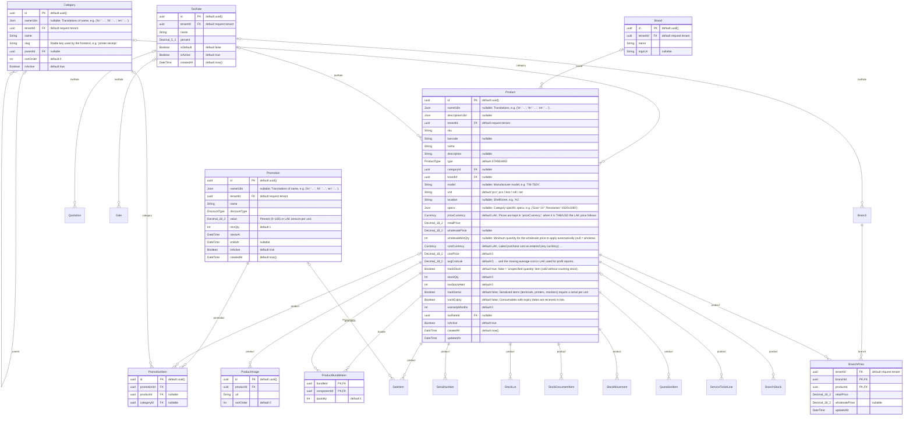
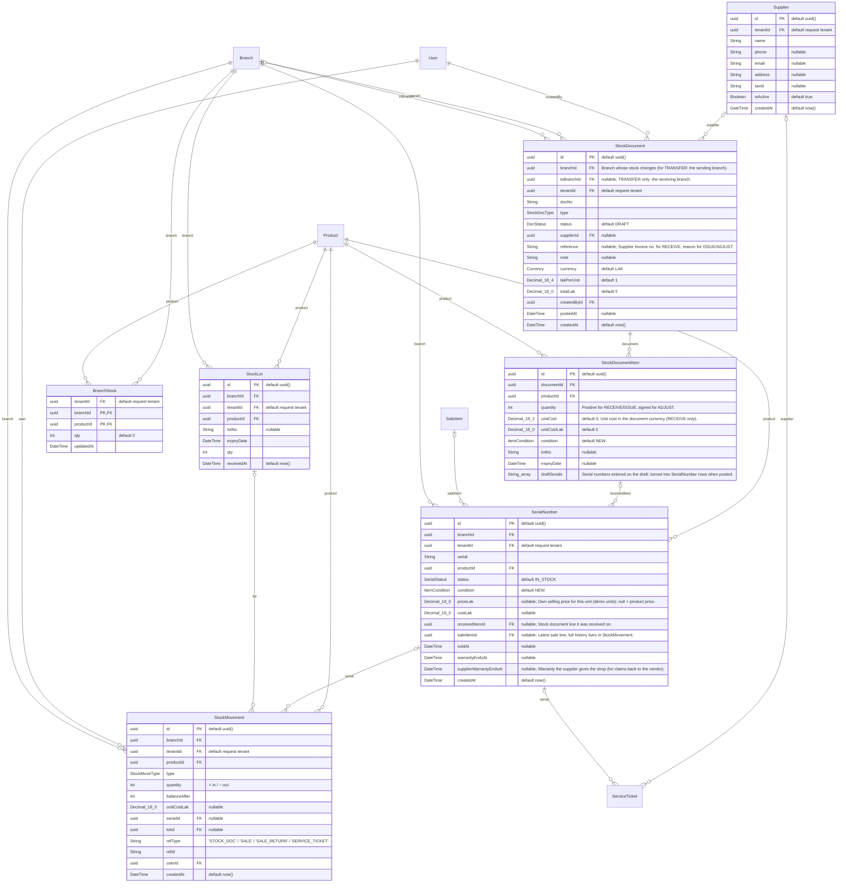
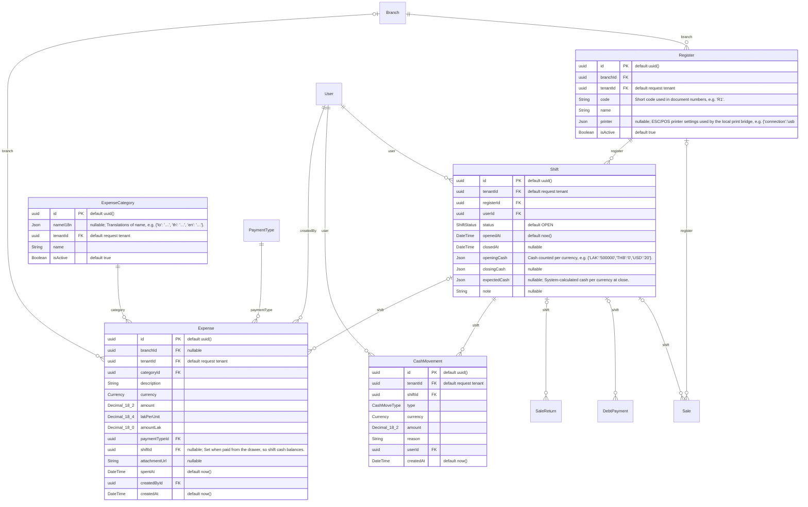
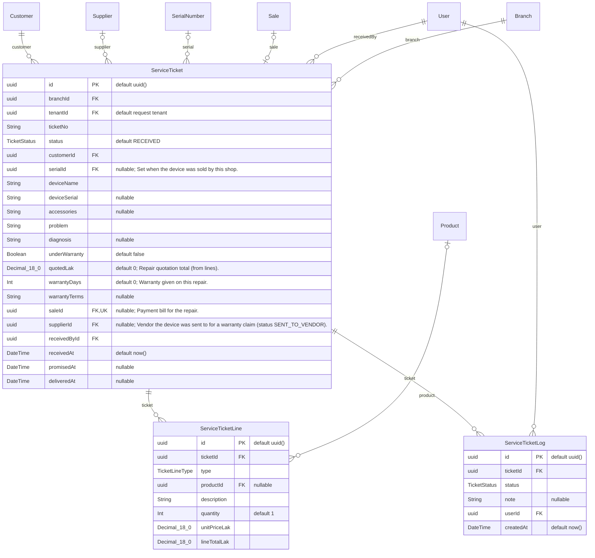

# ER Diagram — PLC POS

> Generated from `prisma/schema.prisma` by `pnpm docs:er`. Do not edit by hand; change the schema and regenerate.

**53 tables · 21 enums · 136 relations.** Design notes: [database-design.md](./database-design.md).

## Conventions

- Primary keys are UUID strings (`id`, generated by the app) unless marked otherwise; composite keys are listed under each table.
- **Multi-company:** 38 tables have `tenantId → Tenant.id`, defaulted from the request (`current_setting('app.tenant_id')`); every query is scoped by the Prisma tenant extension (`src/prisma/tenant-extension.ts`). These links are drawn only in the first diagram.
- Money: LAK `Decimal(18,0)`, THB/USD `Decimal(18,2)`, exchange rates `Decimal(18,4)`, percents `Decimal(5,2)`. Translated names are JSON `nameI18n` maps (`{"lo","th","en"}`).
- Cardinality: `||--o{` one-to-many, `||--o|` one-to-one, `|o--` optional parent (nullable foreign key). Labels are the Prisma relation field.
- Keys: **PK** primary key, **FK** foreign key, **UK** unique.

## Contents

1. [Overview (all relations)](#overview)
2. [Companies, plans and system — ບໍລິສັດ, ແພັກເກດ ແລະ ລະບົບ](#companies-plans-and-system)
3. [Users, permissions and audit — ຜູ້ໃຊ້, ສິດ ແລະ ປະຫວັດ](#users-permissions-and-audit)
4. [Catalog, prices and promotions — ສິນຄ້າ, ລາຄາ ແລະ ໂປຣໂມຊັນ](#catalog-prices-and-promotions)
5. [Stock, serials and suppliers — ສາງ, serial ແລະ ຜູ້ສະໜອງ](#stock-serials-and-suppliers)
6. [Customers, quotations and sales — ລູກຄ້າ, ໃບສະເໜີລາຄາ ແລະ ການຂາຍ](#customers-quotations-and-sales)
7. [Registers, shifts and expenses — ເຄື່ອງຂາຍ, ກະ ແລະ ລາຍຈ່າຍ](#registers-shifts-and-expenses)
8. [Repairs and warranty claims — ງານສ້ອມ ແລະ ເຄມປະກັນ](#repairs-and-warranty-claims)
9. [Enums](#enums)

## Overview

Every table and every foreign key except the `tenantId` links (see Conventions).

```mermaid
erDiagram
  UserGroup ||--o{ User : "group"
  User ||--o{ RefreshToken : "user"
  User |o--o{ AuditLog : "user"
  User |o--o{ ExchangeRate : "createdBy"
  Category |o--o{ Category : "parent"
  Category |o--o{ Product : "category"
  Brand |o--o{ Product : "brand"
  TaxRate |o--o{ Product : "taxRate"
  Product ||--o{ ProductImage : "product"
  Product ||--o{ ProductBundleItem : "bundle"
  Product ||--o{ ProductBundleItem : "component"
  Promotion ||--o{ PromotionItem : "promotion"
  Product |o--o{ PromotionItem : "product"
  Category |o--o{ PromotionItem : "category"
  Product ||--o{ SerialNumber : "product"
  StockDocumentItem |o--o{ SerialNumber : "receivedItem"
  SaleItem |o--o{ SerialNumber : "saleItem"
  Branch ||--o{ SerialNumber : "branch"
  Product ||--o{ StockLot : "product"
  Branch ||--o{ StockLot : "branch"
  Supplier |o--o{ StockDocument : "supplier"
  User ||--o{ StockDocument : "createdBy"
  Branch ||--o{ StockDocument : "branch"
  Branch |o--o{ StockDocument : "toBranch"
  StockDocument ||--o{ StockDocumentItem : "document"
  Product ||--o{ StockDocumentItem : "product"
  Product ||--o{ StockMovement : "product"
  SerialNumber |o--o{ StockMovement : "serial"
  StockLot |o--o{ StockMovement : "lot"
  User ||--o{ StockMovement : "user"
  Branch ||--o{ StockMovement : "branch"
  User ||--o{ HeldBill : "cashier"
  Customer |o--o{ HeldBill : "customer"
  Branch |o--o{ HeldBill : "branch"
  Customer ||--o{ Quotation : "customer"
  TaxRate |o--o{ Quotation : "taxRate"
  User ||--o{ Quotation : "createdBy"
  Branch |o--o{ Quotation : "branch"
  Quotation ||--o{ QuotationItem : "quotation"
  Product ||--o{ QuotationItem : "product"
  User ||--o{ Sale : "cashier"
  User |o--o{ Sale : "voidedBy"
  Register |o--o{ Sale : "register"
  Shift |o--o{ Sale : "shift"
  Customer |o--o{ Sale : "customer"
  Quotation |o--o| Sale : "quotation"
  TaxRate |o--o{ Sale : "taxRate"
  Branch ||--o{ Sale : "branch"
  Sale ||--o{ TaxInvoice : "sale"
  User ||--o{ TaxInvoice : "issuedBy"
  Sale ||--o{ SaleItem : "sale"
  Product ||--o{ SaleItem : "product"
  User |o--o{ SaleItem : "priceOverriddenBy"
  Promotion |o--o{ SaleItem : "promotion"
  Sale ||--o{ Payment : "sale"
  PaymentType ||--o{ Payment : "paymentType"
  Customer ||--o{ DebtPayment : "customer"
  Sale ||--o{ DebtPayment : "sale"
  PaymentType ||--o{ DebtPayment : "paymentType"
  Shift |o--o{ DebtPayment : "shift"
  User ||--o{ DebtPayment : "receivedBy"
  Branch |o--o{ DebtPayment : "branch"
  Sale ||--o{ SaleReturn : "sale"
  Shift |o--o{ SaleReturn : "shift"
  PaymentType ||--o{ SaleReturn : "paymentType"
  User ||--o{ SaleReturn : "createdBy"
  SaleReturn ||--o{ SaleReturnItem : "saleReturn"
  SaleItem ||--o{ SaleReturnItem : "saleItem"
  Branch ||--o{ Register : "branch"
  Register ||--o{ Shift : "register"
  User ||--o{ Shift : "user"
  Shift ||--o{ CashMovement : "shift"
  User ||--o{ CashMovement : "user"
  ExpenseCategory ||--o{ Expense : "category"
  PaymentType ||--o{ Expense : "paymentType"
  Shift |o--o{ Expense : "shift"
  User ||--o{ Expense : "createdBy"
  Branch |o--o{ Expense : "branch"
  Customer ||--o{ ServiceTicket : "customer"
  Supplier |o--o{ ServiceTicket : "supplier"
  SerialNumber |o--o{ ServiceTicket : "serial"
  Sale |o--o| ServiceTicket : "sale"
  User ||--o{ ServiceTicket : "receivedBy"
  Branch ||--o{ ServiceTicket : "branch"
  ServiceTicket ||--o{ ServiceTicketLine : "ticket"
  Product |o--o{ ServiceTicketLine : "product"
  ServiceTicket ||--o{ ServiceTicketLog : "ticket"
  User ||--o{ ServiceTicketLog : "user"
  TaxRate |o--o{ Branch : "taxRate"
  Branch ||--o{ BranchStock : "branch"
  Product ||--o{ BranchStock : "product"
  User ||--o{ UserBranch : "user"
  Branch ||--o{ UserBranch : "branch"
  Plan ||--o{ Subscription : "plan"
  Branch ||--o{ BranchPrice : "branch"
  Product ||--o{ BranchPrice : "product"
  User ||--o{ UserToken : "user"
  Plan ||--o{ BillingInvoice : "plan"
```

## Companies, plans and system

ບໍລິສັດ, ແພັກເກດ ແລະ ລະບົບ. Tables from other sections appear as empty boxes.

```mermaid
erDiagram
  Tenant {
    uuid id PK "default uuid()"
    String code UK "Short code typed at login, e.g. 'plc'."
    String name
    String legalName "nullable"
    String taxId "nullable"
    String phone "nullable"
    String email "nullable"
    String defaultLanguage "default 'lo'; lo / th / en"
    Boolean isActive "default true"
    DateTime createdAt "default now()"
    DateTime updatedAt
  }
  Branch {
    uuid id PK "default uuid()"
    uuid tenantId FK "default request tenant"
    String code
    String name
    String address "nullable"
    String phone "nullable"
    String receiptHeader "nullable; Extra line printed on receipts of this branch."
    uuid taxRateId FK "nullable; VAT rate for sales of this branch; null uses the company's default rate."
    Boolean isActive "default true"
    DateTime createdAt "default now()"
    DateTime updatedAt
  }
  Plan {
    uuid id PK "default uuid()"
    String code UK
    String name
    Json nameI18n "nullable"
    Json descriptionI18n "nullable"
    Decimal_18_0 priceMonthlyLak "default 0"
    Decimal_18_0 priceYearlyLak "default 0"
    Json limits "{ maxBranches, maxRegisters, maxUsers, maxProducts, maxSalesPerMonth } — null = unlimited."
    String_array features "Feature keys, see src/plans/features.ts."
    Int trialDays "default 14"
    Boolean isPublic "default true; Shown on the public plan list / signup."
    Boolean isActive "default true"
    Int sortOrder "default 0"
    DateTime createdAt "default now()"
    DateTime updatedAt
  }
  Subscription {
    uuid id PK "default uuid()"
    uuid tenantId FK, UK
    uuid planId FK
    SubscriptionStatus status "default TRIAL"
    DateTime trialEndsAt "nullable"
    DateTime currentPeriodEnd "nullable"
    Json overrides "nullable; Per-tenant changes: { limits?: {...}, featuresAdd?: [], featuresRemove?: [] }."
    String note "nullable"
    DateTime createdAt "default now()"
    DateTime updatedAt
  }
  BillingInvoice {
    uuid id PK "default uuid()"
    uuid tenantId FK "default request tenant"
    String number
    uuid planId FK
    Int months
    Decimal_18_0 amountLak
    InvoiceStatus status "default PENDING"
    String method "nullable; BANK_TRANSFER, ONLINE, MANUAL …"
    String reference "nullable"
    DateTime paidAt "nullable"
    DateTime createdAt "default now()"
    DateTime updatedAt
  }
  SignupRequest {
    uuid id PK "default uuid()"
    String email
    String code "Company code asked for (re-checked when verifying)."
    Json payload "Sign-up form without the plain password (passwordHash instead)."
    String codeHash
    Int attempts "default 0"
    DateTime expiresAt
    DateTime verifiedAt "nullable"
    DateTime createdAt "default now()"
  }
  PlatformAdmin {
    uuid id PK "default uuid()"
    String email UK
    String passwordHash
    String fullName
    Boolean isActive "default true"
    Int failedLoginCount "default 0"
    DateTime lockedUntil "nullable"
    DateTime createdAt "default now()"
    DateTime updatedAt
  }
  Setting {
    String key PK
    uuid tenantId PK, FK "default request tenant"
    Json value
    DateTime updatedAt
  }
  DocSequence {
    String key PK
    uuid tenantId PK, FK "default request tenant"
    Int value
  }
  IdempotencyKey {
    uuid tenantId PK, FK "default request tenant"
    String key PK
    String userId
    String method
    String path
    String requestHash "SHA-256 of the request body: the same key with a different body is refused."
    Int statusCode "nullable"
    Json response "nullable"
    DateTime createdAt "default now()"
  }
  Tenant ||--o{ UserGroup : "tenant"
  Tenant ||--o{ User : "tenant"
  Tenant ||--o{ Setting : "tenant"
  Tenant ||--o{ DocSequence : "tenant"
  Tenant |o--o{ AuditLog : "tenant"
  Tenant ||--o{ PaymentType : "tenant"
  Tenant ||--o{ TaxRate : "tenant"
  Tenant ||--o{ ExchangeRate : "tenant"
  Tenant ||--o{ Category : "tenant"
  Tenant ||--o{ Brand : "tenant"
  Tenant ||--o{ Product : "tenant"
  Tenant ||--o{ Promotion : "tenant"
  Tenant ||--o{ SerialNumber : "tenant"
  Branch ||--o{ SerialNumber : "branch"
  Tenant ||--o{ StockLot : "tenant"
  Branch ||--o{ StockLot : "branch"
  Tenant ||--o{ Supplier : "tenant"
  Tenant ||--o{ StockDocument : "tenant"
  Branch ||--o{ StockDocument : "branch"
  Branch |o--o{ StockDocument : "toBranch"
  Tenant ||--o{ StockMovement : "tenant"
  Branch ||--o{ StockMovement : "branch"
  Tenant ||--o{ Customer : "tenant"
  Tenant ||--o{ HeldBill : "tenant"
  Branch |o--o{ HeldBill : "branch"
  Tenant ||--o{ Quotation : "tenant"
  Branch |o--o{ Quotation : "branch"
  Tenant ||--o{ Sale : "tenant"
  Branch ||--o{ Sale : "branch"
  Tenant ||--o{ TaxInvoice : "tenant"
  Tenant ||--o{ SaleItem : "tenant"
  Tenant ||--o{ DebtPayment : "tenant"
  Branch |o--o{ DebtPayment : "branch"
  Tenant ||--o{ SaleReturn : "tenant"
  Tenant ||--o{ Register : "tenant"
  Branch ||--o{ Register : "branch"
  Tenant ||--o{ Shift : "tenant"
  Tenant ||--o{ CashMovement : "tenant"
  Tenant ||--o{ ExpenseCategory : "tenant"
  Tenant ||--o{ Expense : "tenant"
  Branch |o--o{ Expense : "branch"
  Tenant ||--o{ ServiceTicket : "tenant"
  Branch ||--o{ ServiceTicket : "branch"
  Tenant ||--o{ Branch : "tenant"
  TaxRate |o--o{ Branch : "taxRate"
  Tenant ||--o{ BranchStock : "tenant"
  Branch ||--o{ BranchStock : "branch"
  Branch ||--o{ UserBranch : "branch"
  Tenant ||--o| Subscription : "tenant"
  Plan ||--o{ Subscription : "plan"
  Tenant ||--o{ IdempotencyKey : "tenant"
  Tenant ||--o{ BranchPrice : "tenant"
  Branch ||--o{ BranchPrice : "branch"
  Tenant ||--o{ UserToken : "tenant"
  Tenant ||--o{ BillingInvoice : "tenant"
  Plan ||--o{ BillingInvoice : "plan"
```

### Tenant

A company renting the POS. Every tenant table carries tenantId (docs/saas-design.md).

| Column | Type | Null | Default | Key | Description |
|---|---|---|---|---|---|
| `id` | `uuid` |  | `uuid()` | PK |  |
| `code` | `String` |  |  | UK | Short code typed at login, e.g. 'plc'. |
| `name` | `String` |  |  |  |  |
| `legalName` | `String` | yes |  |  |  |
| `taxId` | `String` | yes |  |  |  |
| `phone` | `String` | yes |  |  |  |
| `email` | `String` | yes |  |  |  |
| `defaultLanguage` | `String` |  | `'lo'` |  | lo / th / en |
| `isActive` | `Boolean` |  | `true` |  |  |
| `createdAt` | `DateTime` |  | `now()` |  |  |
| `updatedAt` | `DateTime` |  |  |  |  |

### Branch

| Column | Type | Null | Default | Key | Description |
|---|---|---|---|---|---|
| `id` | `uuid` |  | `uuid()` | PK |  |
| `tenantId` | `uuid` |  | `request tenant` | FK | → `Tenant.id` |
| `code` | `String` |  |  |  |  |
| `name` | `String` |  |  |  |  |
| `address` | `String` | yes |  |  |  |
| `phone` | `String` | yes |  |  |  |
| `receiptHeader` | `String` | yes |  |  | Extra line printed on receipts of this branch. |
| `taxRateId` | `uuid` | yes |  | FK | → `TaxRate.id` VAT rate for sales of this branch; null uses the company's default rate. |
| `isActive` | `Boolean` |  | `true` |  |  |
| `createdAt` | `DateTime` |  | `now()` |  |  |
| `updatedAt` | `DateTime` |  |  |  |  |

Keys and indexes: `@@unique([tenantId, code])`

### Plan

A package the platform sells. Limits/features are editable at any time.

| Column | Type | Null | Default | Key | Description |
|---|---|---|---|---|---|
| `id` | `uuid` |  | `uuid()` | PK |  |
| `code` | `String` |  |  | UK |  |
| `name` | `String` |  |  |  |  |
| `nameI18n` | `Json` | yes |  |  |  |
| `descriptionI18n` | `Json` | yes |  |  |  |
| `priceMonthlyLak` | `Decimal(18,0)` |  | `0` |  |  |
| `priceYearlyLak` | `Decimal(18,0)` |  | `0` |  |  |
| `limits` | `Json` |  |  |  | { maxBranches, maxRegisters, maxUsers, maxProducts, maxSalesPerMonth } — null = unlimited. |
| `features` | `String[]` |  |  |  | Feature keys, see src/plans/features.ts. |
| `trialDays` | `Int` |  | `14` |  |  |
| `isPublic` | `Boolean` |  | `true` |  | Shown on the public plan list / signup. |
| `isActive` | `Boolean` |  | `true` |  |  |
| `sortOrder` | `Int` |  | `0` |  |  |
| `createdAt` | `DateTime` |  | `now()` |  |  |
| `updatedAt` | `DateTime` |  |  |  |  |

### Subscription

| Column | Type | Null | Default | Key | Description |
|---|---|---|---|---|---|
| `id` | `uuid` |  | `uuid()` | PK |  |
| `tenantId` | `uuid` |  |  | FK, UK | → `Tenant.id` |
| `planId` | `uuid` |  |  | FK | → `Plan.id` |
| `status` | enum `SubscriptionStatus` |  | `TRIAL` |  |  |
| `trialEndsAt` | `DateTime` | yes |  |  |  |
| `currentPeriodEnd` | `DateTime` | yes |  |  |  |
| `overrides` | `Json` | yes |  |  | Per-tenant changes: { limits?: {...}, featuresAdd?: [], featuresRemove?: [] }. |
| `note` | `String` | yes |  |  |  |
| `createdAt` | `DateTime` |  | `now()` |  |  |
| `updatedAt` | `DateTime` |  |  |  |  |

Keys and indexes: `@@index([planId])`

### BillingInvoice

Invoice for a plan period, paid by bank transfer or an online gateway.

| Column | Type | Null | Default | Key | Description |
|---|---|---|---|---|---|
| `id` | `uuid` |  | `uuid()` | PK |  |
| `tenantId` | `uuid` |  | `request tenant` | FK | → `Tenant.id` |
| `number` | `String` |  |  |  |  |
| `planId` | `uuid` |  |  | FK | → `Plan.id` |
| `months` | `Int` |  |  |  |  |
| `amountLak` | `Decimal(18,0)` |  |  |  |  |
| `status` | enum `InvoiceStatus` |  | `PENDING` |  |  |
| `method` | `String` | yes |  |  | BANK_TRANSFER, ONLINE, MANUAL … |
| `reference` | `String` | yes |  |  |  |
| `paidAt` | `DateTime` | yes |  |  |  |
| `createdAt` | `DateTime` |  | `now()` |  |  |
| `updatedAt` | `DateTime` |  |  |  |  |

Keys and indexes: `@@unique([tenantId, number])` · `@@index([status, createdAt])` · `@@index([planId])`

### SignupRequest

A sign-up waiting for its e-mail code. The company is created only after verification. Not tenant data: there is no tenant yet.

| Column | Type | Null | Default | Key | Description |
|---|---|---|---|---|---|
| `id` | `uuid` |  | `uuid()` | PK |  |
| `email` | `String` |  |  |  |  |
| `code` | `String` |  |  |  | Company code asked for (re-checked when verifying). |
| `payload` | `Json` |  |  |  | Sign-up form without the plain password (passwordHash instead). |
| `codeHash` | `String` |  |  |  |  |
| `attempts` | `Int` |  | `0` |  |  |
| `expiresAt` | `DateTime` |  |  |  |  |
| `verifiedAt` | `DateTime` | yes |  |  |  |
| `createdAt` | `DateTime` |  | `now()` |  |  |

Keys and indexes: `@@index([email, createdAt])`

### PlatformAdmin

Platform staff (us). Separate login realm from tenant users.

| Column | Type | Null | Default | Key | Description |
|---|---|---|---|---|---|
| `id` | `uuid` |  | `uuid()` | PK |  |
| `email` | `String` |  |  | UK |  |
| `passwordHash` | `String` |  |  |  |  |
| `fullName` | `String` |  |  |  |  |
| `isActive` | `Boolean` |  | `true` |  |  |
| `failedLoginCount` | `Int` |  | `0` |  |  |
| `lockedUntil` | `DateTime` | yes |  |  |  |
| `createdAt` | `DateTime` |  | `now()` |  |  |
| `updatedAt` | `DateTime` |  |  |  |  |

### Setting

Key–value settings: "store.name", "store.phone", "store.address", "store.logoUrl", "receipt.defaultSize" (58mm|80mm|A5|A4), "receipt.footer", "repair.warrantyTerms", "tax.pricesIncludeVat", "docNo.prefix.sale" …

| Column | Type | Null | Default | Key | Description |
|---|---|---|---|---|---|
| `key` | `String` |  |  | PK |  |
| `tenantId` | `uuid` |  | `request tenant` | PK, FK | → `Tenant.id` |
| `value` | `Json` |  |  |  |  |
| `updatedAt` | `DateTime` |  |  |  |  |

Keys and indexes: `@@id([tenantId, key])`

### DocSequence

Running counters for document numbers, keyed by prefix + scope, e.g. "S-R1-261026" or "INV-2026".

| Column | Type | Null | Default | Key | Description |
|---|---|---|---|---|---|
| `key` | `String` |  |  | PK |  |
| `tenantId` | `uuid` |  | `request tenant` | PK, FK | → `Tenant.id` |
| `value` | `Int` |  |  |  |  |

Keys and indexes: `@@id([tenantId, key])`

### IdempotencyKey

Replays the stored response when a client retries a request with the same Idempotency-Key.

| Column | Type | Null | Default | Key | Description |
|---|---|---|---|---|---|
| `tenantId` | `uuid` |  | `request tenant` | PK, FK | → `Tenant.id` |
| `key` | `String` |  |  | PK |  |
| `userId` | `String` |  |  |  |  |
| `method` | `String` |  |  |  |  |
| `path` | `String` |  |  |  |  |
| `requestHash` | `String` |  |  |  | SHA-256 of the request body: the same key with a different body is refused. |
| `statusCode` | `Int` | yes |  |  |  |
| `response` | `Json` | yes |  |  |  |
| `createdAt` | `DateTime` |  | `now()` |  |  |

Keys and indexes: `@@id([tenantId, key])` · `@@index([createdAt])`

## Users, permissions and audit

ຜູ້ໃຊ້, ສິດ ແລະ ປະຫວັດ. Tables from other sections appear as empty boxes.

```mermaid
erDiagram
  UserGroup {
    uuid id PK "default uuid()"
    uuid tenantId FK "default request tenant"
    String name
    String_array permissions
    Boolean isSystem "default false; Built-in groups (Admin, Manager, Cashier, Viewer) cannot be deleted."
    DateTime createdAt "default now()"
    DateTime updatedAt
  }
  User {
    uuid id PK "default uuid()"
    String language "nullable; Preferred UI/API language: lo / th / en (null = tenant default)."
    uuid tenantId FK "default request tenant"
    String username
    String passwordHash
    String pinHash "nullable; 4–6 digit PIN (hashed) for quick cashier login and manager approval at the till."
    Int failedLoginCount "default 0; Consecutive failed password/PIN attempts; reset on success."
    DateTime lockedUntil "nullable; Set after 5 failed attempts; login is refused until this time."
    String fullName
    String email "nullable; Optional (cashiers on PIN need none); unique within the company."
    DateTime emailVerifiedAt "nullable"
    String googleSub "nullable; Google account id ('sub') for Sign in with Google."
    uuid groupId FK
    Boolean isActive "default true"
    DateTime createdAt "default now()"
    DateTime updatedAt
  }
  UserBranch {
    uuid userId PK, FK
    uuid branchId PK, FK
  }
  RefreshToken {
    uuid id PK "default uuid()"
    uuid userId FK
    String tokenHash UK
    DateTime expiresAt
    DateTime revokedAt "nullable"
    DateTime createdAt "default now()"
  }
  UserToken {
    uuid id PK "default uuid()"
    uuid tenantId FK "default request tenant"
    uuid userId FK
    UserTokenPurpose purpose
    String email
    String tokenHash UK
    DateTime expiresAt
    DateTime usedAt "nullable"
    DateTime createdAt "default now()"
  }
  AuditLog {
    uuid id PK "default uuid()"
    uuid tenantId FK "nullable"
    uuid userId FK "nullable"
    String action "e.g. 'SALE_VOID', 'SALE_REPRINT', 'PRICE_OVERRIDE', 'PRODUCT_PRICE_BULK_UPDATE'"
    String entity
    String entityId "nullable"
    Json before "nullable"
    Json after "nullable"
    DateTime createdAt "default now()"
  }
  UserGroup ||--o{ User : "group"
  User ||--o{ RefreshToken : "user"
  User |o--o{ AuditLog : "user"
  User |o--o{ ExchangeRate : "createdBy"
  User ||--o{ StockDocument : "createdBy"
  User ||--o{ StockMovement : "user"
  User ||--o{ HeldBill : "cashier"
  User ||--o{ Quotation : "createdBy"
  User ||--o{ Sale : "cashier"
  User |o--o{ Sale : "voidedBy"
  User ||--o{ TaxInvoice : "issuedBy"
  User |o--o{ SaleItem : "priceOverriddenBy"
  User ||--o{ DebtPayment : "receivedBy"
  User ||--o{ SaleReturn : "createdBy"
  User ||--o{ Shift : "user"
  User ||--o{ CashMovement : "user"
  User ||--o{ Expense : "createdBy"
  User ||--o{ ServiceTicket : "receivedBy"
  User ||--o{ ServiceTicketLog : "user"
  User ||--o{ UserBranch : "user"
  Branch ||--o{ UserBranch : "branch"
  User ||--o{ UserToken : "user"
```

### UserGroup

Configurable user group with a list of permission codes, e.g. ["sale.create","sale.void","price.override"].

| Column | Type | Null | Default | Key | Description |
|---|---|---|---|---|---|
| `id` | `uuid` |  | `uuid()` | PK |  |
| `tenantId` | `uuid` |  | `request tenant` | FK | → `Tenant.id` |
| `name` | `String` |  |  |  |  |
| `permissions` | `String[]` |  |  |  |  |
| `isSystem` | `Boolean` |  | `false` |  | Built-in groups (Admin, Manager, Cashier, Viewer) cannot be deleted. |
| `createdAt` | `DateTime` |  | `now()` |  |  |
| `updatedAt` | `DateTime` |  |  |  |  |

Keys and indexes: `@@unique([tenantId, name])`

### User

| Column | Type | Null | Default | Key | Description |
|---|---|---|---|---|---|
| `id` | `uuid` |  | `uuid()` | PK |  |
| `language` | `String` | yes |  |  | Preferred UI/API language: lo / th / en (null = tenant default). |
| `tenantId` | `uuid` |  | `request tenant` | FK | → `Tenant.id` |
| `username` | `String` |  |  |  |  |
| `passwordHash` | `String` |  |  |  |  |
| `pinHash` | `String` | yes |  |  | 4–6 digit PIN (hashed) for quick cashier login and manager approval at the till. |
| `failedLoginCount` | `Int` |  | `0` |  | Consecutive failed password/PIN attempts; reset on success. |
| `lockedUntil` | `DateTime` | yes |  |  | Set after 5 failed attempts; login is refused until this time. |
| `fullName` | `String` |  |  |  |  |
| `email` | `String` | yes |  |  | Optional (cashiers on PIN need none); unique within the company. |
| `emailVerifiedAt` | `DateTime` | yes |  |  |  |
| `googleSub` | `String` | yes |  |  | Google account id ('sub') for Sign in with Google. |
| `groupId` | `uuid` |  |  | FK | → `UserGroup.id` |
| `isActive` | `Boolean` |  | `true` |  |  |
| `createdAt` | `DateTime` |  | `now()` |  |  |
| `updatedAt` | `DateTime` |  |  |  |  |

Keys and indexes: `@@unique([tenantId, username])` · `@@unique([tenantId, email])` · `@@unique([tenantId, googleSub])` · `@@index([email])`

### UserBranch

Branches a user may work in; a user without rows may work in every branch.

| Column | Type | Null | Default | Key | Description |
|---|---|---|---|---|---|
| `userId` | `uuid` |  |  | PK, FK | → `User.id` |
| `branchId` | `uuid` |  |  | PK, FK | → `Branch.id` |

Keys and indexes: `@@id([userId, branchId])` · `@@index([branchId])`

### RefreshToken

| Column | Type | Null | Default | Key | Description |
|---|---|---|---|---|---|
| `id` | `uuid` |  | `uuid()` | PK |  |
| `userId` | `uuid` |  |  | FK | → `User.id` |
| `tokenHash` | `String` |  |  | UK |  |
| `expiresAt` | `DateTime` |  |  |  |  |
| `revokedAt` | `DateTime` | yes |  |  |  |
| `createdAt` | `DateTime` |  | `now()` |  |  |

Keys and indexes: `@@index([userId])`

### UserToken

One-time e-mail links (verify address, reset password). Only the hash is stored.

| Column | Type | Null | Default | Key | Description |
|---|---|---|---|---|---|
| `id` | `uuid` |  | `uuid()` | PK |  |
| `tenantId` | `uuid` |  | `request tenant` | FK | → `Tenant.id` |
| `userId` | `uuid` |  |  | FK | → `User.id` |
| `purpose` | enum `UserTokenPurpose` |  |  |  |  |
| `email` | `String` |  |  |  |  |
| `tokenHash` | `String` |  |  | UK |  |
| `expiresAt` | `DateTime` |  |  |  |  |
| `usedAt` | `DateTime` | yes |  |  |  |
| `createdAt` | `DateTime` |  | `now()` |  |  |

Keys and indexes: `@@index([userId, purpose])` · `@@index([tenantId])`

### AuditLog

| Column | Type | Null | Default | Key | Description |
|---|---|---|---|---|---|
| `id` | `uuid` |  | `uuid()` | PK |  |
| `tenantId` | `uuid` | yes |  | FK | → `Tenant.id` |
| `userId` | `uuid` | yes |  | FK | → `User.id` |
| `action` | `String` |  |  |  | e.g. 'SALE_VOID', 'SALE_REPRINT', 'PRICE_OVERRIDE', 'PRODUCT_PRICE_BULK_UPDATE' |
| `entity` | `String` |  |  |  |  |
| `entityId` | `String` | yes |  |  |  |
| `before` | `Json` | yes |  |  |  |
| `after` | `Json` | yes |  |  |  |
| `createdAt` | `DateTime` |  | `now()` |  |  |

Keys and indexes: `@@index([entity, entityId])` · `@@index([createdAt])` · `@@index([tenantId])`

## Catalog, prices and promotions

ສິນຄ້າ, ລາຄາ ແລະ ໂປຣໂມຊັນ. Tables from other sections appear as empty boxes.

### Category

| Column | Type | Null | Default | Key | Description |
|---|---|---|---|---|---|
| `id` | `uuid` |  | `uuid()` | PK |  |
| `nameI18n` | `Json` | yes |  |  | Translations of name, e.g. {'lo': '…', 'th': '…', 'en': '…'}. |
| `tenantId` | `uuid` |  | `request tenant` | FK | → `Tenant.id` |
| `name` | `String` |  |  |  |  |
| `slug` | `String` |  |  |  | Stable key used by the frontend, e.g. 'printer-receipt'. |
| `parentId` | `uuid` | yes |  | FK | → `Category.id` |
| `sortOrder` | `Int` |  | `0` |  |  |
| `isActive` | `Boolean` |  | `true` |  |  |

Keys and indexes: `@@unique([tenantId, parentId, name])` · `@@unique([tenantId, slug])`

### Brand

| Column | Type | Null | Default | Key | Description |
|---|---|---|---|---|---|
| `id` | `uuid` |  | `uuid()` | PK |  |
| `tenantId` | `uuid` |  | `request tenant` | FK | → `Tenant.id` |
| `name` | `String` |  |  |  |  |
| `logoUrl` | `String` | yes |  |  |  |

Keys and indexes: `@@unique([tenantId, name])`

### Product

| Column | Type | Null | Default | Key | Description |
|---|---|---|---|---|---|
| `id` | `uuid` |  | `uuid()` | PK |  |
| `nameI18n` | `Json` | yes |  |  | Translations, e.g. {'lo': '…', 'th': '…', 'en': '…'}. |
| `descriptionI18n` | `Json` | yes |  |  |  |
| `tenantId` | `uuid` |  | `request tenant` | FK | → `Tenant.id` |
| `sku` | `String` |  |  |  |  |
| `barcode` | `String` | yes |  |  |  |
| `name` | `String` |  |  |  |  |
| `description` | `String` | yes |  |  |  |
| `type` | enum `ProductType` |  | `STANDARD` |  |  |
| `categoryId` | `uuid` | yes |  | FK | → `Category.id` |
| `brandId` | `uuid` | yes |  | FK | → `Brand.id` |
| `model` | `String` | yes |  |  | Manufacturer model, e.g. 'TM-T82X'. |
| `unit` | `String` |  | `'pcs'` |  | pcs / box / roll / set |
| `location` | `String` | yes |  |  | Shelf/zone, e.g. 'A1'. |
| `specs` | `Json` | yes |  |  | Category-specific specs, e.g. {'Size':'24\'','Resolution':'1920x1080'}. |
| `priceCurrency` | enum `Currency` |  | `LAK` |  | Prices are kept in `priceCurrency`; when it is THB/USD the LAK price follows the current exchange rate. |
| `retailPrice` | `Decimal(18,2)` |  |  |  |  |
| `wholesalePrice` | `Decimal(18,2)` | yes |  |  |  |
| `wholesaleMinQty` | `Int` | yes |  |  | Minimum quantity for the wholesale price to apply automatically (null = wholesale customers only). |
| `costCurrency` | enum `Currency` |  | `LAK` |  | Latest purchase cost as entered (any currency) … |
| `costPrice` | `Decimal(18,2)` |  | `0` |  |  |
| `avgCostLak` | `Decimal(18,0)` |  | `0` |  | … and the moving-average cost in LAK used for profit reports. |
| `trackStock` | `Boolean` |  | `true` |  | false = 'unspecified quantity' item (sold without counting stock). |
| `stockQty` | `Int` |  | `0` |  |  |
| `lowStockAlert` | `Int` |  | `0` |  |  |
| `trackSerial` | `Boolean` |  | `false` |  | Serialized items (terminals, printers, monitors) require a serial per unit sold. |
| `trackExpiry` | `Boolean` |  | `false` |  | Consumables with expiry dates are received in lots. |
| `warrantyMonths` | `Int` |  | `0` |  |  |
| `taxRateId` | `uuid` | yes |  | FK | → `TaxRate.id` |
| `isActive` | `Boolean` |  | `true` |  |  |
| `createdAt` | `DateTime` |  | `now()` |  |  |
| `updatedAt` | `DateTime` |  |  |  |  |

Keys and indexes: `@@unique([tenantId, sku])` · `@@unique([tenantId, barcode])` · `@@index([categoryId])` · `@@index([brandId])` · `@@index([name(ops: raw("gin_trgm_ops"))], type: Gin, map: "Product_name_trgm_idx")` · `@@index([sku(ops: raw("gin_trgm_ops"))], type: Gin, map: "Product_sku_trgm_idx")` · `@@index([barcode(ops: raw("gin_trgm_ops"))], type: Gin, map: "Product_barcode_trgm_idx")` · `@@index([model(ops: raw("gin_trgm_ops"))], type: Gin, map: "Product_model_trgm_idx")`

### ProductImage

| Column | Type | Null | Default | Key | Description |
|---|---|---|---|---|---|
| `id` | `uuid` |  | `uuid()` | PK |  |
| `productId` | `uuid` |  |  | FK | → `Product.id` |
| `url` | `String` |  |  |  |  |
| `sortOrder` | `Int` |  | `0` |  |  |

Keys and indexes: `@@index([productId])`

### ProductBundleItem

Components of a BUNDLE product, e.g. "Restaurant POS set" = terminal + drawer + printer + scanner.

| Column | Type | Null | Default | Key | Description |
|---|---|---|---|---|---|
| `bundleId` | `uuid` |  |  | PK, FK | → `Product.id` |
| `componentId` | `uuid` |  |  | PK, FK | → `Product.id` |
| `quantity` | `Int` |  | `1` |  |  |

Keys and indexes: `@@id([bundleId, componentId])`

### BranchPrice

Selling price of a product at one branch (in the product's price currency). No row: the product's own price applies; wholesalePrice null: the product's wholesale price.

| Column | Type | Null | Default | Key | Description |
|---|---|---|---|---|---|
| `tenantId` | `uuid` |  | `request tenant` | FK | → `Tenant.id` |
| `branchId` | `uuid` |  |  | PK, FK | → `Branch.id` |
| `productId` | `uuid` |  |  | PK, FK | → `Product.id` |
| `retailPrice` | `Decimal(18,2)` |  |  |  |  |
| `wholesalePrice` | `Decimal(18,2)` | yes |  |  |  |
| `updatedAt` | `DateTime` |  |  |  |  |

Keys and indexes: `@@id([branchId, productId])` · `@@index([productId])` · `@@index([tenantId])`

### TaxRate

VAT/tax rates. Exactly one should be the default; a branch may use another (Branch.taxRateId).

| Column | Type | Null | Default | Key | Description |
|---|---|---|---|---|---|
| `id` | `uuid` |  | `uuid()` | PK |  |
| `tenantId` | `uuid` |  | `request tenant` | FK | → `Tenant.id` |
| `name` | `String` |  |  |  |  |
| `percent` | `Decimal(5,2)` |  |  |  |  |
| `isDefault` | `Boolean` |  | `false` |  |  |
| `isActive` | `Boolean` |  | `true` |  |  |
| `createdAt` | `DateTime` |  | `now()` |  |  |

Keys and indexes: `@@unique([tenantId, name])`

### Promotion

| Column | Type | Null | Default | Key | Description |
|---|---|---|---|---|---|
| `id` | `uuid` |  | `uuid()` | PK |  |
| `nameI18n` | `Json` | yes |  |  | Translations of name, e.g. {'lo': '…', 'th': '…', 'en': '…'}. |
| `tenantId` | `uuid` |  | `request tenant` | FK | → `Tenant.id` |
| `name` | `String` |  |  |  |  |
| `discountType` | enum `DiscountType` |  |  |  |  |
| `value` | `Decimal(18,2)` |  |  |  | Percent (0–100) or LAK amount per unit. |
| `minQty` | `Int` |  | `1` |  |  |
| `startsAt` | `DateTime` |  |  |  |  |
| `endsAt` | `DateTime` | yes |  |  |  |
| `isActive` | `Boolean` |  | `true` |  |  |
| `createdAt` | `DateTime` |  | `now()` |  |  |

Keys and indexes: `@@index([tenantId])`

### PromotionItem

Promotion target: either one product or a whole category.

| Column | Type | Null | Default | Key | Description |
|---|---|---|---|---|---|
| `id` | `uuid` |  | `uuid()` | PK |  |
| `promotionId` | `uuid` |  |  | FK | → `Promotion.id` |
| `productId` | `uuid` | yes |  | FK | → `Product.id` |
| `categoryId` | `uuid` | yes |  | FK | → `Category.id` |

Keys and indexes: `@@index([promotionId])`

## Stock, serials and suppliers

ສາງ, serial ແລະ ຜູ້ສະໜອງ. Tables from other sections appear as empty boxes.

### Supplier

| Column | Type | Null | Default | Key | Description |
|---|---|---|---|---|---|
| `id` | `uuid` |  | `uuid()` | PK |  |
| `tenantId` | `uuid` |  | `request tenant` | FK | → `Tenant.id` |
| `name` | `String` |  |  |  |  |
| `phone` | `String` | yes |  |  |  |
| `email` | `String` | yes |  |  |  |
| `address` | `String` | yes |  |  |  |
| `taxId` | `String` | yes |  |  |  |
| `isActive` | `Boolean` |  | `true` |  |  |
| `createdAt` | `DateTime` |  | `now()` |  |  |

Keys and indexes: `@@index([tenantId])`

### StockDocument

Goods receipt / stock issue / stock adjustment document.

| Column | Type | Null | Default | Key | Description |
|---|---|---|---|---|---|
| `id` | `uuid` |  | `uuid()` | PK |  |
| `branchId` | `uuid` |  |  | FK | → `Branch.id` Branch whose stock changes (for TRANSFER: the sending branch). |
| `toBranchId` | `uuid` | yes |  | FK | → `Branch.id` TRANSFER only: the receiving branch. |
| `tenantId` | `uuid` |  | `request tenant` | FK | → `Tenant.id` |
| `docNo` | `String` |  |  |  |  |
| `type` | enum `StockDocType` |  |  |  |  |
| `status` | enum `DocStatus` |  | `DRAFT` |  |  |
| `supplierId` | `uuid` | yes |  | FK | → `Supplier.id` |
| `reference` | `String` | yes |  |  | Supplier invoice no. for RECEIVE, reason for ISSUE/ADJUST. |
| `note` | `String` | yes |  |  |  |
| `currency` | enum `Currency` |  | `LAK` |  |  |
| `lakPerUnit` | `Decimal(18,4)` |  | `1` |  |  |
| `totalLak` | `Decimal(18,0)` |  | `0` |  |  |
| `createdById` | `uuid` |  |  | FK | → `User.id` |
| `postedAt` | `DateTime` | yes |  |  |  |
| `createdAt` | `DateTime` |  | `now()` |  |  |

Keys and indexes: `@@unique([tenantId, docNo])` · `@@index([type, createdAt])` · `@@index([branchId])`

### StockDocumentItem

| Column | Type | Null | Default | Key | Description |
|---|---|---|---|---|---|
| `id` | `uuid` |  | `uuid()` | PK |  |
| `documentId` | `uuid` |  |  | FK | → `StockDocument.id` |
| `productId` | `uuid` |  |  | FK | → `Product.id` |
| `quantity` | `Int` |  |  |  | Positive for RECEIVE/ISSUE; signed for ADJUST. |
| `unitCost` | `Decimal(18,2)` |  | `0` |  | Unit cost in the document currency (RECEIVE only). |
| `unitCostLak` | `Decimal(18,0)` |  | `0` |  |  |
| `condition` | enum `ItemCondition` |  | `NEW` |  |  |
| `lotNo` | `String` | yes |  |  |  |
| `expiryDate` | `DateTime` | yes |  |  |  |
| `draftSerials` | `String[]` |  |  |  | Serial numbers entered on the draft; turned into SerialNumber rows when posted. |

Keys and indexes: `@@index([documentId])` · `@@index([productId])`

### StockMovement

Stock ledger — insert-only. Product.stockQty must equal the sum of `quantity` per product.

| Column | Type | Null | Default | Key | Description |
|---|---|---|---|---|---|
| `id` | `uuid` |  | `uuid()` | PK |  |
| `branchId` | `uuid` |  |  | FK | → `Branch.id` |
| `tenantId` | `uuid` |  | `request tenant` | FK | → `Tenant.id` |
| `productId` | `uuid` |  |  | FK | → `Product.id` |
| `type` | enum `StockMoveType` |  |  |  |  |
| `quantity` | `Int` |  |  |  | + in / − out |
| `balanceAfter` | `Int` |  |  |  |  |
| `unitCostLak` | `Decimal(18,0)` | yes |  |  |  |
| `serialId` | `uuid` | yes |  | FK | → `SerialNumber.id` |
| `lotId` | `uuid` | yes |  | FK | → `StockLot.id` |
| `refType` | `String` |  |  |  | 'STOCK_DOC' / 'SALE' / 'SALE_RETURN' / 'SERVICE_TICKET' |
| `refId` | `String` |  |  |  |  |
| `userId` | `uuid` |  |  | FK | → `User.id` |
| `createdAt` | `DateTime` |  | `now()` |  |  |

Keys and indexes: `@@index([productId, createdAt])` · `@@index([refType, refId])` · `@@index([tenantId])` · `@@index([branchId])`

### SerialNumber

| Column | Type | Null | Default | Key | Description |
|---|---|---|---|---|---|
| `id` | `uuid` |  | `uuid()` | PK |  |
| `branchId` | `uuid` |  |  | FK | → `Branch.id` |
| `tenantId` | `uuid` |  | `request tenant` | FK | → `Tenant.id` |
| `serial` | `String` |  |  |  |  |
| `productId` | `uuid` |  |  | FK | → `Product.id` |
| `status` | enum `SerialStatus` |  | `IN_STOCK` |  |  |
| `condition` | enum `ItemCondition` |  | `NEW` |  |  |
| `priceLak` | `Decimal(18,0)` | yes |  |  | Own selling price for this unit (demo units); null = product price. |
| `costLak` | `Decimal(18,0)` | yes |  |  |  |
| `receivedItemId` | `uuid` | yes |  | FK | → `StockDocumentItem.id` Stock document line it was received on. |
| `saleItemId` | `uuid` | yes |  | FK | → `SaleItem.id` Latest sale line; full history lives in StockMovement. |
| `soldAt` | `DateTime` | yes |  |  |  |
| `warrantyEndsAt` | `DateTime` | yes |  |  |  |
| `supplierWarrantyEndsAt` | `DateTime` | yes |  |  | Warranty the supplier gives the shop (for claims back to the vendor). |
| `createdAt` | `DateTime` |  | `now()` |  |  |

Keys and indexes: `@@unique([tenantId, serial])` · `@@index([productId, status])` · `@@index([saleItemId])` · `@@index([receivedItemId])` · `@@index([branchId])`

### StockLot

Received lot with an expiry date (thermal paper, ink, batteries …).

| Column | Type | Null | Default | Key | Description |
|---|---|---|---|---|---|
| `id` | `uuid` |  | `uuid()` | PK |  |
| `branchId` | `uuid` |  |  | FK | → `Branch.id` |
| `tenantId` | `uuid` |  | `request tenant` | FK | → `Tenant.id` |
| `productId` | `uuid` |  |  | FK | → `Product.id` |
| `lotNo` | `String` | yes |  |  |  |
| `expiryDate` | `DateTime` |  |  |  |  |
| `qty` | `Int` |  |  |  |  |
| `receivedAt` | `DateTime` |  | `now()` |  |  |

Keys and indexes: `@@index([expiryDate])` · `@@index([productId, expiryDate])` · `@@index([tenantId])` · `@@index([branchId])`

### BranchStock

On-hand quantity per branch. Product.stockQty is the sum over branches.

| Column | Type | Null | Default | Key | Description |
|---|---|---|---|---|---|
| `tenantId` | `uuid` |  | `request tenant` | FK | → `Tenant.id` |
| `branchId` | `uuid` |  |  | PK, FK | → `Branch.id` |
| `productId` | `uuid` |  |  | PK, FK | → `Product.id` |
| `qty` | `Int` |  | `0` |  |  |
| `updatedAt` | `DateTime` |  |  |  |  |

Keys and indexes: `@@id([branchId, productId])` · `@@index([tenantId])` · `@@index([productId])`

## Customers, quotations and sales

ລູກຄ້າ, ໃບສະເໜີລາຄາ ແລະ ການຂາຍ. Tables from other sections appear as empty boxes.

```mermaid
erDiagram
  Customer {
    uuid id PK "default uuid()"
    uuid tenantId FK "default request tenant"
    String code
    String name
    CustomerType type "default INDIVIDUAL"
    String companyName "nullable"
    String taxId "nullable"
    String phone "nullable"
    String email "nullable"
    String address "nullable"
    PriceTier priceTier "default RETAIL"
    Decimal_18_0 creditLimitLak "default 0; 0 = no credit allowed."
    String note "nullable"
    Boolean isActive "default true"
    DateTime createdAt "default now()"
  }
  HeldBill {
    uuid id PK "default uuid()"
    uuid branchId FK "nullable"
    uuid tenantId FK "default request tenant"
    String label "nullable"
    uuid cashierId FK
    uuid customerId FK "nullable"
    Json cart "Cart snapshot: [{productId, quantity, unitPriceLak, discountLak, serials[]}], bill discoun"
    DateTime createdAt "default now()"
  }
  Quotation {
    uuid id PK "default uuid()"
    uuid branchId FK "nullable"
    uuid tenantId FK "default request tenant"
    String quoteNo
    uuid customerId FK
    QuotationStatus status "default DRAFT"
    DateTime validUntil
    Decimal_18_0 subtotalLak
    Decimal_18_0 discountLak "default 0"
    uuid taxRateId FK "nullable"
    Decimal_5_2 vatPercent "default 0"
    Decimal_18_0 vatLak "default 0"
    Decimal_18_0 totalLak
    String note "nullable"
    uuid createdById FK
    DateTime createdAt "default now()"
  }
  QuotationItem {
    uuid id PK "default uuid()"
    uuid quotationId FK
    uuid productId FK
    String productName
    Int quantity
    Decimal_18_0 unitPriceLak
    Decimal_18_0 discountLak "default 0"
    Decimal_18_0 lineTotalLak
  }
  Sale {
    uuid id PK "default uuid()"
    uuid branchId FK
    uuid tenantId FK "default request tenant"
    String receiptNo
    SaleStatus status "default COMPLETED"
    PaymentStatus paymentStatus "default PAID"
    uuid cashierId FK
    uuid registerId FK "nullable"
    uuid shiftId FK "nullable"
    uuid customerId FK "nullable"
    uuid quotationId FK, UK "nullable"
    PriceTier priceTier "default RETAIL"
    Decimal_18_0 subtotalLak
    Decimal_18_0 discountLak "default 0; Whole-bill discount (line discounts are on SaleItem)."
    uuid taxRateId FK "nullable"
    Decimal_5_2 vatPercent "default 0"
    Boolean pricesIncludeVat "default true"
    Decimal_18_0 vatLak "default 0"
    Decimal_18_0 totalLak
    Decimal_18_0 paidLak "default 0; Sum of non-credit payments (+ later debt payments); totalLak − paidLak = outsta"
    Decimal_18_0 changeLak "default 0"
    DateTime dueDate "nullable"
    String note "nullable"
    Int printCount "default 0"
    uuid voidedById FK "nullable"
    DateTime voidedAt "nullable"
    String voidReason "nullable"
    DateTime createdAt "default now()"
  }
  SaleItem {
    uuid id PK "default uuid()"
    uuid tenantId FK "default request tenant"
    uuid saleId FK
    uuid productId FK
    String productName "Snapshot of product name at time of sale."
    Int quantity
    Decimal_18_0 listPriceLak "List price for the tier at sale time …"
    Decimal_18_0 unitPriceLak "… and the price actually charged (differs when overridden or a demo unit)."
    uuid priceOverriddenById FK "nullable"
    uuid promotionId FK "nullable"
    Decimal_18_0 discountLak "default 0"
    Decimal_18_0 lineTotalLak
    Decimal_18_0 unitCostLak "Cost snapshot for profit reports."
    Int warrantyMonths "default 0"
  }
  Payment {
    uuid id PK "default uuid()"
    uuid saleId FK
    uuid paymentTypeId FK
    Currency currency
    Decimal_18_2 amount "Amount tendered in `currency`."
    Decimal_18_4 lakPerUnit "Exchange-rate snapshot (1 for LAK)."
    Decimal_18_0 amountLak
    String reference "nullable; Transfer / QR / card reference."
    DateTime createdAt "default now()"
  }
  PaymentType {
    uuid id PK "default uuid()"
    Json nameI18n "nullable; Translations of name, e.g. {'lo': '…', 'th': '…', 'en': '…'}."
    uuid tenantId FK "default request tenant"
    String name
    PaymentKind kind
    Boolean requiresReference "default false"
    Boolean isActive "default true"
    Int sortOrder "default 0"
  }
  ExchangeRate {
    uuid id PK "default uuid()"
    uuid tenantId FK "default request tenant"
    Currency currency
    Decimal_18_4 lakPerUnit
    DateTime effectiveFrom "default now()"
    uuid createdById FK "nullable"
    DateTime createdAt "default now()"
  }
  TaxInvoice {
    uuid id PK "default uuid()"
    uuid tenantId FK "default request tenant"
    String invoiceNo "Own running sequence, separate from receipt numbers, e.g. 'INV-2026-000123'."
    uuid saleId FK
    String buyerName
    String buyerTaxId "nullable"
    String buyerAddress "nullable"
    String buyerPhone "nullable"
    uuid issuedById FK
    DateTime issuedAt "default now()"
    DateTime cancelledAt "nullable; Cancelled invoices keep their number; a new invoice is issued instead."
    String cancelReason "nullable"
  }
  DebtPayment {
    uuid id PK "default uuid()"
    uuid branchId FK "nullable"
    uuid tenantId FK "default request tenant"
    String receiptNo
    uuid customerId FK
    uuid saleId FK
    uuid paymentTypeId FK
    Currency currency
    Decimal_18_2 amount
    Decimal_18_4 lakPerUnit
    Decimal_18_0 amountLak
    String reference "nullable"
    uuid shiftId FK "nullable"
    uuid receivedById FK
    DateTime createdAt "default now()"
  }
  SaleReturn {
    uuid id PK "default uuid()"
    uuid tenantId FK "default request tenant"
    String returnNo
    uuid saleId FK
    String reason
    Decimal_18_0 refundLak
    uuid paymentTypeId FK
    uuid shiftId FK "nullable; Shift the refund was paid from (cash refunds lower the drawer's expected cash)."
    uuid createdById FK
    DateTime createdAt "default now()"
  }
  SaleReturnItem {
    uuid id PK "default uuid()"
    uuid returnId FK
    uuid saleItemId FK
    Int quantity
    String_array serials
    Boolean restock "default true; false = defective, not put back on sale."
    Decimal_18_0 amountLak
  }
  User |o--o{ ExchangeRate : "createdBy"
  SaleItem |o--o{ SerialNumber : "saleItem"
  User ||--o{ HeldBill : "cashier"
  Customer |o--o{ HeldBill : "customer"
  Branch |o--o{ HeldBill : "branch"
  Customer ||--o{ Quotation : "customer"
  TaxRate |o--o{ Quotation : "taxRate"
  User ||--o{ Quotation : "createdBy"
  Branch |o--o{ Quotation : "branch"
  Quotation ||--o{ QuotationItem : "quotation"
  Product ||--o{ QuotationItem : "product"
  User ||--o{ Sale : "cashier"
  User |o--o{ Sale : "voidedBy"
  Register |o--o{ Sale : "register"
  Shift |o--o{ Sale : "shift"
  Customer |o--o{ Sale : "customer"
  Quotation |o--o| Sale : "quotation"
  TaxRate |o--o{ Sale : "taxRate"
  Branch ||--o{ Sale : "branch"
  Sale ||--o{ TaxInvoice : "sale"
  User ||--o{ TaxInvoice : "issuedBy"
  Sale ||--o{ SaleItem : "sale"
  Product ||--o{ SaleItem : "product"
  User |o--o{ SaleItem : "priceOverriddenBy"
  Promotion |o--o{ SaleItem : "promotion"
  Sale ||--o{ Payment : "sale"
  PaymentType ||--o{ Payment : "paymentType"
  Customer ||--o{ DebtPayment : "customer"
  Sale ||--o{ DebtPayment : "sale"
  PaymentType ||--o{ DebtPayment : "paymentType"
  Shift |o--o{ DebtPayment : "shift"
  User ||--o{ DebtPayment : "receivedBy"
  Branch |o--o{ DebtPayment : "branch"
  Sale ||--o{ SaleReturn : "sale"
  Shift |o--o{ SaleReturn : "shift"
  PaymentType ||--o{ SaleReturn : "paymentType"
  User ||--o{ SaleReturn : "createdBy"
  SaleReturn ||--o{ SaleReturnItem : "saleReturn"
  SaleItem ||--o{ SaleReturnItem : "saleItem"
  PaymentType ||--o{ Expense : "paymentType"
  Customer ||--o{ ServiceTicket : "customer"
  Sale |o--o| ServiceTicket : "sale"
```

### Customer

| Column | Type | Null | Default | Key | Description |
|---|---|---|---|---|---|
| `id` | `uuid` |  | `uuid()` | PK |  |
| `tenantId` | `uuid` |  | `request tenant` | FK | → `Tenant.id` |
| `code` | `String` |  |  |  |  |
| `name` | `String` |  |  |  |  |
| `type` | enum `CustomerType` |  | `INDIVIDUAL` |  |  |
| `companyName` | `String` | yes |  |  |  |
| `taxId` | `String` | yes |  |  |  |
| `phone` | `String` | yes |  |  |  |
| `email` | `String` | yes |  |  |  |
| `address` | `String` | yes |  |  |  |
| `priceTier` | enum `PriceTier` |  | `RETAIL` |  |  |
| `creditLimitLak` | `Decimal(18,0)` |  | `0` |  | 0 = no credit allowed. |
| `note` | `String` | yes |  |  |  |
| `isActive` | `Boolean` |  | `true` |  |  |
| `createdAt` | `DateTime` |  | `now()` |  |  |

Keys and indexes: `@@unique([tenantId, code])` · `@@unique([tenantId, phone])` · `@@index([name(ops: raw("gin_trgm_ops"))], type: Gin, map: "Customer_name_trgm_idx")` · `@@index([phone(ops: raw("gin_trgm_ops"))], type: Gin, map: "Customer_phone_trgm_idx")`

### HeldBill

Parked ("held") cart that does not touch stock until it is completed as a Sale.

| Column | Type | Null | Default | Key | Description |
|---|---|---|---|---|---|
| `id` | `uuid` |  | `uuid()` | PK |  |
| `branchId` | `uuid` | yes |  | FK | → `Branch.id` |
| `tenantId` | `uuid` |  | `request tenant` | FK | → `Tenant.id` |
| `label` | `String` | yes |  |  |  |
| `cashierId` | `uuid` |  |  | FK | → `User.id` |
| `customerId` | `uuid` | yes |  | FK | → `Customer.id` |
| `cart` | `Json` |  |  |  | Cart snapshot: [{productId, quantity, unitPriceLak, discountLak, serials[]}], bill discount, note. |
| `createdAt` | `DateTime` |  | `now()` |  |  |

Keys and indexes: `@@index([cashierId])` · `@@index([tenantId])` · `@@index([branchId])`

### Quotation

| Column | Type | Null | Default | Key | Description |
|---|---|---|---|---|---|
| `id` | `uuid` |  | `uuid()` | PK |  |
| `branchId` | `uuid` | yes |  | FK | → `Branch.id` |
| `tenantId` | `uuid` |  | `request tenant` | FK | → `Tenant.id` |
| `quoteNo` | `String` |  |  |  |  |
| `customerId` | `uuid` |  |  | FK | → `Customer.id` |
| `status` | enum `QuotationStatus` |  | `DRAFT` |  |  |
| `validUntil` | `DateTime` |  |  |  |  |
| `subtotalLak` | `Decimal(18,0)` |  |  |  |  |
| `discountLak` | `Decimal(18,0)` |  | `0` |  |  |
| `taxRateId` | `uuid` | yes |  | FK | → `TaxRate.id` |
| `vatPercent` | `Decimal(5,2)` |  | `0` |  |  |
| `vatLak` | `Decimal(18,0)` |  | `0` |  |  |
| `totalLak` | `Decimal(18,0)` |  |  |  |  |
| `note` | `String` | yes |  |  |  |
| `createdById` | `uuid` |  |  | FK | → `User.id` |
| `createdAt` | `DateTime` |  | `now()` |  |  |

Keys and indexes: `@@unique([tenantId, quoteNo])` · `@@index([customerId])` · `@@index([branchId])`

### QuotationItem

| Column | Type | Null | Default | Key | Description |
|---|---|---|---|---|---|
| `id` | `uuid` |  | `uuid()` | PK |  |
| `quotationId` | `uuid` |  |  | FK | → `Quotation.id` |
| `productId` | `uuid` |  |  | FK | → `Product.id` |
| `productName` | `String` |  |  |  |  |
| `quantity` | `Int` |  |  |  |  |
| `unitPriceLak` | `Decimal(18,0)` |  |  |  |  |
| `discountLak` | `Decimal(18,0)` |  | `0` |  |  |
| `lineTotalLak` | `Decimal(18,0)` |  |  |  |  |

Keys and indexes: `@@index([quotationId])`

### Sale

| Column | Type | Null | Default | Key | Description |
|---|---|---|---|---|---|
| `id` | `uuid` |  | `uuid()` | PK |  |
| `branchId` | `uuid` |  |  | FK | → `Branch.id` |
| `tenantId` | `uuid` |  | `request tenant` | FK | → `Tenant.id` |
| `receiptNo` | `String` |  |  |  |  |
| `status` | enum `SaleStatus` |  | `COMPLETED` |  |  |
| `paymentStatus` | enum `PaymentStatus` |  | `PAID` |  |  |
| `cashierId` | `uuid` |  |  | FK | → `User.id` |
| `registerId` | `uuid` | yes |  | FK | → `Register.id` |
| `shiftId` | `uuid` | yes |  | FK | → `Shift.id` |
| `customerId` | `uuid` | yes |  | FK | → `Customer.id` |
| `quotationId` | `uuid` | yes |  | FK, UK | → `Quotation.id` |
| `priceTier` | enum `PriceTier` |  | `RETAIL` |  |  |
| `subtotalLak` | `Decimal(18,0)` |  |  |  |  |
| `discountLak` | `Decimal(18,0)` |  | `0` |  | Whole-bill discount (line discounts are on SaleItem). |
| `taxRateId` | `uuid` | yes |  | FK | → `TaxRate.id` |
| `vatPercent` | `Decimal(5,2)` |  | `0` |  |  |
| `pricesIncludeVat` | `Boolean` |  | `true` |  |  |
| `vatLak` | `Decimal(18,0)` |  | `0` |  |  |
| `totalLak` | `Decimal(18,0)` |  |  |  |  |
| `paidLak` | `Decimal(18,0)` |  | `0` |  | Sum of non-credit payments (+ later debt payments); totalLak − paidLak = outstanding debt. |
| `changeLak` | `Decimal(18,0)` |  | `0` |  |  |
| `dueDate` | `DateTime` | yes |  |  |  |
| `note` | `String` | yes |  |  |  |
| `printCount` | `Int` |  | `0` |  |  |
| `voidedById` | `uuid` | yes |  | FK | → `User.id` |
| `voidedAt` | `DateTime` | yes |  |  |  |
| `voidReason` | `String` | yes |  |  |  |
| `createdAt` | `DateTime` |  | `now()` |  |  |

Keys and indexes: `@@unique([tenantId, receiptNo])` · `@@index([tenantId, createdAt])` · `@@index([customerId, paymentStatus])` · `@@index([shiftId])` · `@@index([tenantId, status, createdAt])` · `@@index([cashierId, createdAt])` · `@@index([branchId])`

### SaleItem

| Column | Type | Null | Default | Key | Description |
|---|---|---|---|---|---|
| `id` | `uuid` |  | `uuid()` | PK |  |
| `tenantId` | `uuid` |  | `request tenant` | FK | → `Tenant.id` |
| `saleId` | `uuid` |  |  | FK | → `Sale.id` |
| `productId` | `uuid` |  |  | FK | → `Product.id` |
| `productName` | `String` |  |  |  | Snapshot of product name at time of sale. |
| `quantity` | `Int` |  |  |  |  |
| `listPriceLak` | `Decimal(18,0)` |  |  |  | List price for the tier at sale time … |
| `unitPriceLak` | `Decimal(18,0)` |  |  |  | … and the price actually charged (differs when overridden or a demo unit). |
| `priceOverriddenById` | `uuid` | yes |  | FK | → `User.id` |
| `promotionId` | `uuid` | yes |  | FK | → `Promotion.id` |
| `discountLak` | `Decimal(18,0)` |  | `0` |  |  |
| `lineTotalLak` | `Decimal(18,0)` |  |  |  |  |
| `unitCostLak` | `Decimal(18,0)` |  |  |  | Cost snapshot for profit reports. |
| `warrantyMonths` | `Int` |  | `0` |  |  |

Keys and indexes: `@@index([saleId])` · `@@index([productId])` · `@@index([tenantId])`

### Payment

One sale may be paid with several payments in different currencies and types.

| Column | Type | Null | Default | Key | Description |
|---|---|---|---|---|---|
| `id` | `uuid` |  | `uuid()` | PK |  |
| `saleId` | `uuid` |  |  | FK | → `Sale.id` |
| `paymentTypeId` | `uuid` |  |  | FK | → `PaymentType.id` |
| `currency` | enum `Currency` |  |  |  |  |
| `amount` | `Decimal(18,2)` |  |  |  | Amount tendered in `currency`. |
| `lakPerUnit` | `Decimal(18,4)` |  |  |  | Exchange-rate snapshot (1 for LAK). |
| `amountLak` | `Decimal(18,0)` |  |  |  |  |
| `reference` | `String` | yes |  |  | Transfer / QR / card reference. |
| `createdAt` | `DateTime` |  | `now()` |  |  |

Keys and indexes: `@@index([saleId])`

### PaymentType

Payment types the shop accepts; can be switched on/off. e.g. "Cash", "BCEL One QR", "LDB transfer", "Credit (debt)".

| Column | Type | Null | Default | Key | Description |
|---|---|---|---|---|---|
| `id` | `uuid` |  | `uuid()` | PK |  |
| `nameI18n` | `Json` | yes |  |  | Translations of name, e.g. {'lo': '…', 'th': '…', 'en': '…'}. |
| `tenantId` | `uuid` |  | `request tenant` | FK | → `Tenant.id` |
| `name` | `String` |  |  |  |  |
| `kind` | enum `PaymentKind` |  |  |  |  |
| `requiresReference` | `Boolean` |  | `false` |  |  |
| `isActive` | `Boolean` |  | `true` |  |  |
| `sortOrder` | `Int` |  | `0` |  |  |

Keys and indexes: `@@unique([tenantId, name])`

### ExchangeRate

Units of LAK per 1 unit of `currency` (e.g. USD → 21800). The latest row per currency is current.

| Column | Type | Null | Default | Key | Description |
|---|---|---|---|---|---|
| `id` | `uuid` |  | `uuid()` | PK |  |
| `tenantId` | `uuid` |  | `request tenant` | FK | → `Tenant.id` |
| `currency` | enum `Currency` |  |  |  |  |
| `lakPerUnit` | `Decimal(18,4)` |  |  |  |  |
| `effectiveFrom` | `DateTime` |  | `now()` |  |  |
| `createdById` | `uuid` | yes |  | FK | → `User.id` |
| `createdAt` | `DateTime` |  | `now()` |  |  |

Keys and indexes: `@@index([currency, effectiveFrom])` · `@@index([tenantId])`

### TaxInvoice

Formal VAT invoice (A4) for a sale. Buyer details are snapshotted so later customer edits don't change issued invoices. At most one non-cancelled invoice per sale (partial unique index in the migration).

| Column | Type | Null | Default | Key | Description |
|---|---|---|---|---|---|
| `id` | `uuid` |  | `uuid()` | PK |  |
| `tenantId` | `uuid` |  | `request tenant` | FK | → `Tenant.id` |
| `invoiceNo` | `String` |  |  |  | Own running sequence, separate from receipt numbers, e.g. 'INV-2026-000123'. |
| `saleId` | `uuid` |  |  | FK | → `Sale.id` |
| `buyerName` | `String` |  |  |  |  |
| `buyerTaxId` | `String` | yes |  |  |  |
| `buyerAddress` | `String` | yes |  |  |  |
| `buyerPhone` | `String` | yes |  |  |  |
| `issuedById` | `uuid` |  |  | FK | → `User.id` |
| `issuedAt` | `DateTime` |  | `now()` |  |  |
| `cancelledAt` | `DateTime` | yes |  |  | Cancelled invoices keep their number; a new invoice is issued instead. |
| `cancelReason` | `String` | yes |  |  |  |

Keys and indexes: `@@unique([tenantId, invoiceNo])` · `@@index([saleId])` · `@@index([issuedAt])`

### DebtPayment

Customer paying off credit-sale debt (may be partial).

| Column | Type | Null | Default | Key | Description |
|---|---|---|---|---|---|
| `id` | `uuid` |  | `uuid()` | PK |  |
| `branchId` | `uuid` | yes |  | FK | → `Branch.id` |
| `tenantId` | `uuid` |  | `request tenant` | FK | → `Tenant.id` |
| `receiptNo` | `String` |  |  |  |  |
| `customerId` | `uuid` |  |  | FK | → `Customer.id` |
| `saleId` | `uuid` |  |  | FK | → `Sale.id` |
| `paymentTypeId` | `uuid` |  |  | FK | → `PaymentType.id` |
| `currency` | enum `Currency` |  |  |  |  |
| `amount` | `Decimal(18,2)` |  |  |  |  |
| `lakPerUnit` | `Decimal(18,4)` |  |  |  |  |
| `amountLak` | `Decimal(18,0)` |  |  |  |  |
| `reference` | `String` | yes |  |  |  |
| `shiftId` | `uuid` | yes |  | FK | → `Shift.id` |
| `receivedById` | `uuid` |  |  | FK | → `User.id` |
| `createdAt` | `DateTime` |  | `now()` |  |  |

Keys and indexes: `@@unique([tenantId, receiptNo])` · `@@index([customerId, createdAt])` · `@@index([saleId])` · `@@index([shiftId])` · `@@index([branchId])`

### SaleReturn

| Column | Type | Null | Default | Key | Description |
|---|---|---|---|---|---|
| `id` | `uuid` |  | `uuid()` | PK |  |
| `tenantId` | `uuid` |  | `request tenant` | FK | → `Tenant.id` |
| `returnNo` | `String` |  |  |  |  |
| `saleId` | `uuid` |  |  | FK | → `Sale.id` |
| `reason` | `String` |  |  |  |  |
| `refundLak` | `Decimal(18,0)` |  |  |  |  |
| `paymentTypeId` | `uuid` |  |  | FK | → `PaymentType.id` |
| `shiftId` | `uuid` | yes |  | FK | → `Shift.id` Shift the refund was paid from (cash refunds lower the drawer's expected cash). |
| `createdById` | `uuid` |  |  | FK | → `User.id` |
| `createdAt` | `DateTime` |  | `now()` |  |  |

Keys and indexes: `@@unique([tenantId, returnNo])` · `@@index([saleId])` · `@@index([shiftId])` · `@@index([createdAt])`

### SaleReturnItem

| Column | Type | Null | Default | Key | Description |
|---|---|---|---|---|---|
| `id` | `uuid` |  | `uuid()` | PK |  |
| `returnId` | `uuid` |  |  | FK | → `SaleReturn.id` |
| `saleItemId` | `uuid` |  |  | FK | → `SaleItem.id` |
| `quantity` | `Int` |  |  |  |  |
| `serials` | `String[]` |  |  |  |  |
| `restock` | `Boolean` |  | `true` |  | false = defective, not put back on sale. |
| `amountLak` | `Decimal(18,0)` |  |  |  |  |

Keys and indexes: `@@index([returnId])` · `@@index([saleItemId])`

## Registers, shifts and expenses

ເຄື່ອງຂາຍ, ກະ ແລະ ລາຍຈ່າຍ. Tables from other sections appear as empty boxes.

### Register

A till / checkout counter. Each has its own receipt printer, cash drawer and shift.

| Column | Type | Null | Default | Key | Description |
|---|---|---|---|---|---|
| `id` | `uuid` |  | `uuid()` | PK |  |
| `branchId` | `uuid` |  |  | FK | → `Branch.id` |
| `tenantId` | `uuid` |  | `request tenant` | FK | → `Tenant.id` |
| `code` | `String` |  |  |  | Short code used in document numbers, e.g. 'R1'. |
| `name` | `String` |  |  |  |  |
| `printer` | `Json` | yes |  |  | ESC/POS printer settings used by the local print bridge, e.g. {'connection':'usb/lan','host':'192.168.1.50','port':9100,'paperWidth':80,'openDrawer':true}. |
| `isActive` | `Boolean` |  | `true` |  |  |

Keys and indexes: `@@unique([tenantId, code])` · `@@index([branchId])`

### Shift

At most one OPEN shift per register (enforced by a partial unique index in the migration).

| Column | Type | Null | Default | Key | Description |
|---|---|---|---|---|---|
| `id` | `uuid` |  | `uuid()` | PK |  |
| `tenantId` | `uuid` |  | `request tenant` | FK | → `Tenant.id` |
| `registerId` | `uuid` |  |  | FK | → `Register.id` |
| `userId` | `uuid` |  |  | FK | → `User.id` |
| `status` | enum `ShiftStatus` |  | `OPEN` |  |  |
| `openedAt` | `DateTime` |  | `now()` |  |  |
| `closedAt` | `DateTime` | yes |  |  |  |
| `openingCash` | `Json` |  |  |  | Cash counted per currency, e.g. {'LAK':'500000','THB':'0','USD':'20'}. |
| `closingCash` | `Json` | yes |  |  |  |
| `expectedCash` | `Json` | yes |  |  | System-calculated cash per currency at close. |
| `note` | `String` | yes |  |  |  |

Keys and indexes: `@@index([registerId, status])` · `@@index([tenantId])`

### CashMovement

Cash put into / taken out of the drawer during a shift (not an expense).

| Column | Type | Null | Default | Key | Description |
|---|---|---|---|---|---|
| `id` | `uuid` |  | `uuid()` | PK |  |
| `tenantId` | `uuid` |  | `request tenant` | FK | → `Tenant.id` |
| `shiftId` | `uuid` |  |  | FK | → `Shift.id` |
| `type` | enum `CashMoveType` |  |  |  |  |
| `currency` | enum `Currency` |  |  |  |  |
| `amount` | `Decimal(18,2)` |  |  |  |  |
| `reason` | `String` |  |  |  |  |
| `userId` | `uuid` |  |  | FK | → `User.id` |
| `createdAt` | `DateTime` |  | `now()` |  |  |

Keys and indexes: `@@index([shiftId])` · `@@index([tenantId])`

### ExpenseCategory

| Column | Type | Null | Default | Key | Description |
|---|---|---|---|---|---|
| `id` | `uuid` |  | `uuid()` | PK |  |
| `nameI18n` | `Json` | yes |  |  | Translations of name, e.g. {'lo': '…', 'th': '…', 'en': '…'}. |
| `tenantId` | `uuid` |  | `request tenant` | FK | → `Tenant.id` |
| `name` | `String` |  |  |  |  |
| `isActive` | `Boolean` |  | `true` |  |  |

Keys and indexes: `@@unique([tenantId, name])`

### Expense

| Column | Type | Null | Default | Key | Description |
|---|---|---|---|---|---|
| `id` | `uuid` |  | `uuid()` | PK |  |
| `branchId` | `uuid` | yes |  | FK | → `Branch.id` |
| `tenantId` | `uuid` |  | `request tenant` | FK | → `Tenant.id` |
| `categoryId` | `uuid` |  |  | FK | → `ExpenseCategory.id` |
| `description` | `String` |  |  |  |  |
| `currency` | enum `Currency` |  |  |  |  |
| `amount` | `Decimal(18,2)` |  |  |  |  |
| `lakPerUnit` | `Decimal(18,4)` |  |  |  |  |
| `amountLak` | `Decimal(18,0)` |  |  |  |  |
| `paymentTypeId` | `uuid` |  |  | FK | → `PaymentType.id` |
| `shiftId` | `uuid` | yes |  | FK | → `Shift.id` Set when paid from the drawer, so shift cash balances. |
| `attachmentUrl` | `String` | yes |  |  |  |
| `spentAt` | `DateTime` |  | `now()` |  |  |
| `createdById` | `uuid` |  |  | FK | → `User.id` |
| `createdAt` | `DateTime` |  | `now()` |  |  |

Keys and indexes: `@@index([spentAt])` · `@@index([shiftId])` · `@@index([categoryId])` · `@@index([tenantId])` · `@@index([branchId])`

## Repairs and warranty claims

ງານສ້ອມ ແລະ ເຄມປະກັນ. Tables from other sections appear as empty boxes.

### ServiceTicket

| Column | Type | Null | Default | Key | Description |
|---|---|---|---|---|---|
| `id` | `uuid` |  | `uuid()` | PK |  |
| `branchId` | `uuid` |  |  | FK | → `Branch.id` |
| `tenantId` | `uuid` |  | `request tenant` | FK | → `Tenant.id` |
| `ticketNo` | `String` |  |  |  |  |
| `status` | enum `TicketStatus` |  | `RECEIVED` |  |  |
| `customerId` | `uuid` |  |  | FK | → `Customer.id` |
| `serialId` | `uuid` | yes |  | FK | → `SerialNumber.id` Set when the device was sold by this shop. |
| `deviceName` | `String` |  |  |  |  |
| `deviceSerial` | `String` | yes |  |  |  |
| `accessories` | `String` | yes |  |  |  |
| `problem` | `String` |  |  |  |  |
| `diagnosis` | `String` | yes |  |  |  |
| `underWarranty` | `Boolean` |  | `false` |  |  |
| `quotedLak` | `Decimal(18,0)` |  | `0` |  | Repair quotation total (from lines). |
| `warrantyDays` | `Int` |  | `0` |  | Warranty given on this repair. |
| `warrantyTerms` | `String` | yes |  |  |  |
| `saleId` | `uuid` | yes |  | FK, UK | → `Sale.id` Payment bill for the repair. |
| `supplierId` | `uuid` | yes |  | FK | → `Supplier.id` Vendor the device was sent to for a warranty claim (status SENT_TO_VENDOR). |
| `receivedById` | `uuid` |  |  | FK | → `User.id` |
| `receivedAt` | `DateTime` |  | `now()` |  |  |
| `promisedAt` | `DateTime` | yes |  |  |  |
| `deliveredAt` | `DateTime` | yes |  |  |  |

Keys and indexes: `@@unique([tenantId, ticketNo])` · `@@index([status])` · `@@index([customerId])` · `@@index([branchId])`

### ServiceTicketLine

Parts and labour on a repair quotation / bill.

| Column | Type | Null | Default | Key | Description |
|---|---|---|---|---|---|
| `id` | `uuid` |  | `uuid()` | PK |  |
| `ticketId` | `uuid` |  |  | FK | → `ServiceTicket.id` |
| `type` | enum `TicketLineType` |  |  |  |  |
| `productId` | `uuid` | yes |  | FK | → `Product.id` |
| `description` | `String` |  |  |  |  |
| `quantity` | `Int` |  | `1` |  |  |
| `unitPriceLak` | `Decimal(18,0)` |  |  |  |  |
| `lineTotalLak` | `Decimal(18,0)` |  |  |  |  |

Keys and indexes: `@@index([ticketId])`

### ServiceTicketLog

Status history of a repair ticket.

| Column | Type | Null | Default | Key | Description |
|---|---|---|---|---|---|
| `id` | `uuid` |  | `uuid()` | PK |  |
| `ticketId` | `uuid` |  |  | FK | → `ServiceTicket.id` |
| `status` | enum `TicketStatus` |  |  |  |  |
| `note` | `String` | yes |  |  |  |
| `userId` | `uuid` |  |  | FK | → `User.id` |
| `createdAt` | `DateTime` |  | `now()` |  |  |

Keys and indexes: `@@index([ticketId])`

## Enums

### Currency

- `LAK`
- `THB`
- `USD`

### PaymentKind

Behaviour behind a configurable payment type.

- `CASH`
- `BANK_TRANSFER`
- `QR`
- `CARD`
- `CREDIT` — Sale on credit: the amount becomes customer debt.

### ProductType

- `STANDARD` — Physical item with stock.
- `BUNDLE` — Set of other products; stock is taken from its components.
- `SERVICE` — Installation, repair labour, software licence: no stock.

### PriceTier

- `RETAIL`
- `WHOLESALE`

### ItemCondition

- `NEW`
- `DEMO` — Display/demo unit sold at its own price.

### SerialStatus

- `IN_STOCK`
- `SOLD`
- `RETURNED`
- `IN_SERVICE`
- `DEFECTIVE`
- `ISSUED` — Taken out of stock by an issue/adjustment document (internal use, damaged, sent back).

### StockMoveType

- `RECEIVE_IN`
- `ISSUE_OUT`
- `ADJUST_IN`
- `ADJUST_OUT`
- `SALE_OUT`
- `RETURN_IN`
- `VOID_IN`
- `TRANSFER_OUT`
- `TRANSFER_IN`

### StockDocType

- `RECEIVE` — Goods received (from a supplier or other source).
- `ISSUE` — Goods taken out of stock (internal use, damaged, expired, sent back).
- `ADJUST` — Stock count correction.
- `TRANSFER` — Moves stock from one branch to another.

### DocStatus

- `DRAFT`
- `POSTED`
- `CANCELLED`

### SaleStatus

- `COMPLETED`
- `VOIDED`

### PaymentStatus

- `PAID`
- `PARTIAL`
- `UNPAID`

### QuotationStatus

- `DRAFT`
- `SENT`
- `ACCEPTED`
- `REJECTED`
- `EXPIRED`
- `CONVERTED`

### DiscountType

- `PERCENT`
- `AMOUNT`

### CustomerType

- `INDIVIDUAL`
- `BUSINESS`

### ShiftStatus

- `OPEN`
- `CLOSED`

### CashMoveType

- `PAY_IN`
- `PAY_OUT`

### TicketStatus

- `RECEIVED`
- `DIAGNOSING`
- `QUOTED`
- `WAITING_PARTS`
- `SENT_TO_VENDOR`
- `REPAIRING`
- `READY`
- `DELIVERED`
- `CANCELLED`

### TicketLineType

- `PART`
- `LABOR`

### SubscriptionStatus

- `TRIAL`
- `ACTIVE`
- `PAST_DUE` — Period ended: usable during the grace period, then read-only.
- `SUSPENDED` — Blocked by the platform (no login).
- `CANCELLED`

### UserTokenPurpose

- `VERIFY_EMAIL`
- `RESET_PASSWORD`

### InvoiceStatus

- `PENDING`
- `PAID`
- `CANCELLED`
